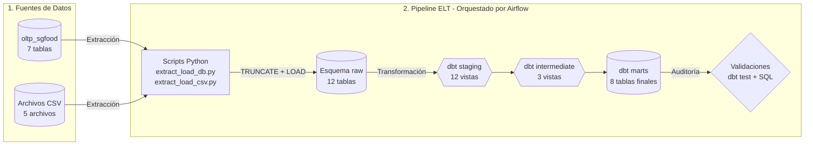
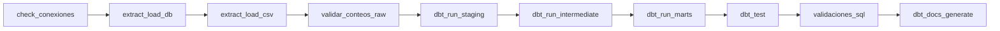

# Proyecto 1 — Flujo moderno de datos SG-Food

### Seminario de Sistemas 2 · USAC · Python + Apache Airflow + dbt + PostgreSQL (Docker Compose)

## 1. Integrantes

| Nombre                               | Carné     |
| ------------------------------------ | --------- |
| Omar Alejandro Vides Esteban - CARNÉ | 201709146 |
| Tobías Rafael Zamora Santos - CARNÉ  | 202010828 |

## 2. Problema y objetivo

**Empresa ficticia:** SG-Food, distribuidora de productos de diversas marcas y categorías,
con 6 sucursales, 80 productos, 250 clientes y ventas entre enero y agosto de 2026.

**Problema:** los procesos son manuales y sin trazabilidad: no hay pruebas de calidad,
los reportes se consultan directo sobre la BD transaccional (que además falla ante
datos sucios) y nadie sabe cuándo ni desde dónde se cargó cada dato.

**Objetivo:** un pipeline ELT reproducible que analice ventas e inventarios:
extracción y carga con Python al schema `raw`, transformación y pruebas con dbt
(`staging` → `intermediate` → `marts`) y orquestación completa con Airflow.

## 3. Arquitectura general



Todo corre con `docker compose`: un contenedor `postgres:15` con dos bases
(`airflow` = metadata de Airflow, `sgfood` = OLTP fuente + DW), Airflow
(webserver + scheduler, `LocalExecutor`) y un contenedor CLI de dbt.
La imagen de Airflow se construye con `dbt-postgres` incluido
(`Dockerfile.airflow` + `requirements.txt`).

## 4. Extracción y carga (scripts Python)

| Script                        | Origen → destino                    | Estrategia                                                                            |
| ----------------------------- | ----------------------------------- | ------------------------------------------------------------------------------------- |
| `scripts/extract_load_db.py`  | `oltp_sgfood` (7 tablas) → `raw`    | `TRUNCATE + INSERT-SELECT` por tabla, limpieza mínima (`TRIM`, `''→NULL`, `CAST`)     |
| `scripts/extract_load_csv.py` | 5 CSV → `raw` (`utf-8-sig` por BOM) | validación de columnas exactas _antes_ de tocar la DB + `TRUNCATE + INSERT` por lotes |
| `scripts/verify_counts.py`    | conteos fuente vs `raw`             | exit 1 ante cualquier diferencia                                                      |

Reglas comunes: configuración **solo por entorno** (sin credenciales; override
para host con `PGHOST/PGPORT/PGUSER/PGPASSWORD/PGDATABASE`), logging con hora,
una transacción por tabla/archivo con rollback parcial, **exit 1** ante fallos
(Airflow lo detecta) y `--dry-run` para validar sin DB. `TRUNCATE+LOAD` se eligió
por idempotencia total con fuentes pequeñas (máx. ~3.8k filas) y recarga determinista.
No se cargan `casos_calidad_opcionales.csv` (lista de casos para los tests dbt) ni el
`.xlsx` (catálogo descriptivo de fuentes, no datos).

## 5. DAG de Airflow (`sgfood_elt`)

Para leer mas sobre el flujo, la documentación detallada esta en:
[`docs/flujo_elt.md`](docs/flujo_elt.md); Doc delFlujo en [`docs/flujo_elt.md`](docs/flujo_elt.md).

Secuencia lineal de 10 tareas (ver `dags/sgfood_elt_dag.py`):



1. `check_conexiones`: Tarea de Python que verifica que las variables de entorno existan y lanza un comando de prueba (`SELECT 1`) para confirmar que la base de datos PostgreSQL acepta conexiones antes de iniciar la carga.

2. `extract_load_db`: Ejecuta un script de Python mediante Bash. Su funcion es copiar exactamente las 7 tablas desde el esquema transaccional de origen hacia el esquema `raw` usando la estrategia de vaciar y llenar (TRUNCATE mas LOAD).

3. `extract_load_csv`: Ejecuta un script de Python mediante Bash. Se encarga de leer exclusivamente los 5 archivos CSV con datos reales y los carga como tablas independientes dentro del esquema `raw`.

4. `validar_conteos_raw`: Es la auditoria inicial. Ejecuta un script que cuenta las filas originales (en los archivos CSV y tablas fuente) y las compara contra las filas recien cargadas en `raw`. Si hay diferencias, el flujo se detiene inmediatamente.

5. `dbt_run_staging`: Inicia la transformacion con dbt filtrando solo la capa `staging`. Toma los datos crudos de `raw`, elimina espacios, corrige tipos de datos y crea vistas limpias.

6. `dbt_run_intermediate`: Ejecuta la capa intermedia de dbt. Aqui se cruzan las vistas limpias y se aplican calculos de negocio, como obtener el subtotal calculado de cada venta o evaluar el estado de bajo inventario.

7. `dbt_run_marts`: Ejecuta la capa final de dbt. Toma los calculos intermedios y construye las tablas fisicas definitivas separadas en dimensiones (catalogos) y tablas de hechos (eventos y metricas).

8. `dbt_test`: Lanza las pruebas de calidad configuradas en dbt. Asegura que las llaves primarias sean unicas, que no existan valores nulos indebidos y que se respeten los estados permitidos de las transacciones.

9. `validaciones_sql`: Corre un script de consultas SQL estricto directamente en la base de datos. Sirve para cazar errores de integridad referencial (registros huerfanos o nulos en claves). Si encuentra un error, lanza una excepcion y marca la tarea en rojo.

10. `dbt_docs_generate`: último paso del pipeline. Genera la documentación web de dbt: el diccionario de datos (modelos, columnas y tipos), las pruebas de cada columna y el mapa de dependencias (lineage) entre las capas `raw → staging → intermediate → marts`. No modifica los datos.

    **Cómo generar y ver la documentación**

    La tarea de Airflow solo genera los archivos en `dbt/target/`. Para verlos en un solo archivo HTML, ejecuta desde la raíz del proyecto:

```bash
    docker compose exec airflow-scheduler bash -c "cd /opt/airflow/dbt && dbt docs generate --static --profiles-dir /opt/airflow/dbt"
    docker compose cp airflow-scheduler:/opt/airflow/dbt/target/static_index.html .
```

    Esto crea el archivo `static_index.html` en la raíz del proyecto. Ábrelo con doble clic o desde la terminal:

```bash
    xdg-open static_index.html     # Linux
```

    En Windows (WSL2) puedes abrirlo con `explorer.exe static_index.html`.

    Dentro de la página, usa el ícono de grafo (abajo a la derecha) para ver el **Lineage** completo del proyecto.

    > Si prefieres un servidor local en lugar del archivo único, copia la carpeta `target/` y sírvela con Python:
    >
    > ```bash
    > docker compose cp airflow-scheduler:/opt/airflow/dbt/target ./dbt_target
    > cd dbt_target && python3 -m http.server 8081
    > ```
    >
    > Luego abre `http://localhost:8081`. Se usa el puerto `8081` porque el `8080` lo ocupa Airflow.

---

- `check_conexiones`: Verifica que las variables de entorno existan y comprueba que la base de datos responda (`SELECT 1`) antes de iniciar el trabajo.

- **Extracción, carga y conteos**: Utiliza comandos de terminal (Bash) para ejecutar los scripts de Python. Estos mueven los datos crudos al esquema `raw` y auditan que la cantidad de filas sea exacta.

- **Transformaciones con dbt**: Construye el Data Warehouse ejecutando las capas en estricto orden (`staging`, `intermediate`, `marts`) y luego lanza `dbt test` para asegurar la calidad de la información.

- `validaciones_sql`: Ejecuta un script de auditoría estricta en la base de datos. Si detecta anomalías (registros huérfanos, duplicados o nulos), lanza una excepción que detiene el flujo y marca la tarea en rojo.

- **Configuración del DAG**: Está programado para ejecución diaria, pero nace pausado para que lo dispares manualmente. Si algo falla, espera 5 minutos y hace hasta 2 reintentos. Además, ignora fechas pasadas (`catchup=False`) y evita ejecuciones simultáneas.

<!-- - **DAG auxiliar (`dbt_build.py`)**: Es un flujo secundario destinado únicamente a pruebas y desarrollo continuo, no forma parte del pipeline principal. -->

## 6. Modelo del Data Warehouse

Esquema estrella en la base `sgfood`, schemas `raw` / `staging` (+ `intermediate`
autocreado por dbt) / `marts`. Diagrama completo y justificación en
[`docs/diseno_dw.md`](docs/diseno_dw.md); DDL en [`sql/ddl_dw.sql`](sql/ddl_dw.sql).

| Tabla                                 | Grano                                        | Clave                                       |
| ------------------------------------- | -------------------------------------------- | ------------------------------------------- |
| `fact_ventas`                         | línea de `venta_detalle` (3209)              | `id_detalle` natural; `id_venta` degenerada |
| `fact_inventario`                     | corte × sucursal × producto (foto periódica) | compuesta                                   |
| `fact_devoluciones`                   | una devolución (sucursal vía venta)          | `id_devolucion` natural                     |
| `fact_metas`                          | mes (día 1) × sucursal                       | compuesta                                   |
| `dim_fecha/producto/cliente/sucursal` | una fila por entidad                         | surrogate entero, SCD tipo 1                |

`dim_producto` va desnormalizada (categoría/marca como columnas);
`dim_fecha` se genera con `generate_series` y mes en español sin depender del locale;
`fact_ventas.subtotal` usa el subtotal **recalculado** (regla auditada por test singular).

## 7. Proyecto dbt (Estructura y Configuración)

- **Capas y Materializaciones (`dbt_project.yml`):** El proyecto está dividido en tres niveles de procesamiento.
  - `staging`: Se materializa como **vistas**. Contiene 12 modelos (`stg_*`) que extraen la información cruda usando `source()`, aplican conversiones de tipo y limpian los datos.
  - `intermediate`: Se materializa como **vistas**. Contiene 3 modelos (`int_*`) encargados de aplicar reglas de negocio y realizar cruces (JOINs) entre tablas usando `ref()`.
  - `marts`: Se materializa como **tablas físicas**. Es el modelo dimensional final, compuesto por 4 dimensiones (`dim_*`) y 4 tablas de hechos (`fact_*`).
  - _Nota:_ Se utiliza el macro personalizado `generate_schema_name.sql` para forzar a que dbt guarde cada capa exactamente en su propio esquema de base de datos (`staging`, `intermediate`, `marts`).
- **Gestión de Fuentes (`sources.yml`):** Conecta dbt con las 12 tablas del esquema `raw`. Incluye controles de "frescura de datos" (`freshness`) vigilando la columna `_loaded_at`; si los datos tienen más de 48 horas emite una advertencia, y si superan las 720 horas lanza un error crítico. La conexión a la base de datos se gestiona dinámicamente leyendo el archivo `.env` desde el perfil `sgfood` en `profiles.yml`.
- **Pruebas de Calidad (Tests):** Se implementó una batería de validaciones estrictas:
  - _Estándar:_ `unique` y `not_null` para proteger las llaves primarias; `relationships` para garantizar que no haya registros huérfanos entre hechos y dimensiones; y `accepted_values` para restringir campos a catálogos reales (ej. estados, métodos de pago, canales).
  - _Singulares:_ Se programaron 2 tests personalizados (basados en `casos_calidad_opcionales.csv`) para ejecutar reglas de negocio complejas: `assert_subtotal_consistente` y `assert_devolucion_no_excede_venta`.
- **Documentación y Comandos:** Todo el diccionario de datos y descripciones viven dentro de los archivos `schema.yml` de cada capa. Los comandos de compilación y despliegue del catálogo web (`dbt docs generate`, `dbt docs serve`) y construcción (`dbt build`, `run`, `test`) se ejecutan a través de Docker utilizando `docker compose exec dbt ...`.

---

## 8. Justificación de Decisiones de Diseño

1.  **OLTP y DWH unificados en el mismo contenedor:** En lugar de levantar servidores de bases de datos independientes, el sistema transaccional simulado y el Data Warehouse conviven en el mismo motor PostgreSQL. Se separan lógicamente mediante esquemas (`oltp_sgfood` vs. `raw`/`staging`/`marts`). Esto simplifica la infraestructura, ahorra memoria RAM y cumple con el alcance del proyecto.
2.  **Esquema `raw` sin restricciones (Constraints):** La capa de aterrizaje de datos debe ser tolerante. Acepta datos "sucios" sin rechazar ni perder filas durante la extracción para mantener una trazabilidad completa. La limpieza y el bloqueo de datos anómalos se delega intencionalmente a los tests de dbt en la capa `staging`.
3.  **Nomenclatura híbrida (Español + Prefijos dbt):** Se mantuvieron los nombres de los campos en español para coincidir exactamente con las fuentes originales y minimizar errores de traducción. Sin embargo, se adoptó el estándar global de dbt para los nombres de los modelos (`stg_`, `int_`, `dim_`, `fact_`) asegurando orden e identificabilidad.
4.  **Devoluciones como tabla de hechos aislada:** No se restan aritméticamente de las ventas de forma directa para no perder el rastro de la operación. Mantenerlas aisladas conserva la dimensión degenerada `motivo`, habilitando análisis posteriores sobre el control de calidad. El cálculo de la "venta neta" se delega a la capa de consumo o reportes.
5.  **Inventario bajo el patrón de Foto Periódica:** Dado que los archivos origen (CSV) no representan transacciones individuales de entrada y salida, sino cortes estáticos, el inventario se modeló como "instantáneas" periódicas. Las banderas de estado (`stock_bajo`, `vencido`) se precalculan desde el modelo para facilitar y acelerar las consultas directas.
6.  **Importación diferida en scripts de Python (`psycopg2`):** Las librerías de conexión a bases de datos solo se invocan en el momento exacto en que se va a cargar la información. Esto permite que comandos de ayuda interactiva (`--help`) o simulaciones puras (`--dry-run`) funcionen de inmediato sin requerir que la librería esté instalada.
7.  **Inclusión deliberada del archivo `.env`:** Aunque las buenas prácticas prohíben subir credenciales a repositorios, se hizo una excepción documentada al tratarse de un entorno académico y local. Se incluye `AIRFLOW_UID=1000` para asegurar que los volúmenes montados (`logs/`, `dags/`) mantengan permisos accesibles y no sean apropiados por el usuario `root` del sistema.

## 9. Validación y resultados esperados

- `scripts/verify_counts.py`: OLTP (1200 ventas, 3209 líneas, 6 sucursales,
  8 categorías, 10 marcas, 80 productos, 250 clientes) y CSV
  (3840/80/48/30/103 filas) coinciden 1:1 con `raw`.
- `dbt build`: 23 modelos en verde, 0 tests fallidos (incluye 2 singulares + freshness).
- `sql/validaciones.sql`: V1 conteos raw↔marts iguales; V2/V3 en cero (bloque `DO`
  lo garantiza con EXCEPTION); A1–A6 analíticas coherentes:
  ventas por marca×mes y categoría×mes, top-10 productos, stock bajo/vencido del
  último corte, % cumplimiento de metas por mes×sucursal y devoluciones por motivo.

## 10. Manual de implementación paso a paso

> El proyecto se levantó y probó en **Linux**. En **Windows** los pasos son los mismos si usas WSL2 (ver sección 10.6).

### 10.1 Prerrequisitos

- Docker con el plugin Compose.
- 4 GB de RAM libres.
- Puertos `5432` (PostgreSQL) y `8080` (Airflow) libres.
- En Linux, tu usuario debe estar en el grupo `docker`. Si `docker ps` da "permission denied", ejecuta `sudo usermod -aG docker $USER` y vuelve a iniciar sesión.

### 10.2 Configurar las credenciales (`.env`)

Copia el archivo de ejemplo y completa las variables:

```bash
cp .env.example .env
```

| Variable                       | Qué poner                                                                            |
| ------------------------------ | ------------------------------------------------------------------------------------ |
| `POSTGRES_PASSWORD`            | La contraseña de la base de datos (ejemplo: `tu_password_db`).                       |
| `AIRFLOW_ADMIN_PASSWORD`       | La contraseña para entrar a la interfaz de Airflow (ejemplo: `tu_password_airflow`). |
| `AIRFLOW_WEBSERVER_SECRET_KEY` | Se genera con el comando de abajo.                                                   |
| `AIRFLOW_FERNET_KEY`           | Se genera con Docker, con el comando de abajo (no necesitas instalar nada).          |

Generar `AIRFLOW_WEBSERVER_SECRET_KEY`:

```bash
python3 -c "import secrets; print(secrets.token_hex(16))"
```

Generar `AIRFLOW_FERNET_KEY`:

```bash
docker run --rm python:3.11-slim bash -c "pip install cryptography --quiet && python -c 'from cryptography.fernet import Fernet; print(Fernet.generate_key().decode())'"
```

Otras variables importantes del `.env`: `POSTGRES_WAREHOUSE_DB=sgfood`, `DBT_HOST=postgres` (dentro de los contenedores), `SGFOOD_SCHEDULE=@daily` y `TZ=America/Guatemala`.

### 10.3 Levantar el entorno (Docker)

Estos comandos preparan Airflow, crean la base de datos `sgfood` con el esquema `oltp_sgfood` (que simula el sistema de origen) y levantan todos los servicios. Ejecútalos **en este orden**:

```bash
docker compose build                # construye la imagen (Airflow + dbt)
docker compose up airflow-init      # prepara Airflow y crea el usuario admin (solo la 1ª vez)
docker compose up -d                # levanta todos los servicios
docker compose exec -T postgres psql -U airflow -d sgfood < sql/ddl_dw.sql   # crea las tablas del DW
```

### 10.4 Ejecutar el flujo de datos

Hay dos formas de correrlo.

**Opción A: desde Airflow (recomendada).** Entra a [http://localhost:8080](http://localhost:8080) con el usuario `airflow` y la contraseña de `AIRFLOW_ADMIN_PASSWORD`. Busca el DAG `sgfood_elt` y presiona **Trigger**. El DAG nace pausado, así que solo corre cuando tú lo activas.

**Opción B: paso a paso desde la terminal.** Sirve para probar cada parte por separado:

```bash
set -a; source .env; set +a
docker compose exec scheduler python3 /opt/airflow/scripts/extract_load_db.py
docker compose exec scheduler python3 /opt/airflow/scripts/extract_load_csv.py --data-dir /opt/airflow/raw-data
docker compose exec scheduler python3 /opt/airflow/scripts/verify_counts.py
docker compose exec dbt dbt build --project-dir /usr/app
```

### 10.5 Conectarte a la base de datos (DBeaver)

| Parámetro     | Valor                     |
| ------------- | ------------------------- |
| Host          | `localhost`               |
| Puerto        | `5432`                    |
| Base de datos | `sgfood`                  |
| Usuario       | `airflow`                 |
| Contraseña    | La de `POSTGRES_PASSWORD` |

### 10.6 Si usas Windows

Todo lo anterior funciona igual si trabajas con **WSL2**. Los pasos son:

1. Instala **Docker Desktop** y activa el backend WSL2 (Settings → General → _Use the WSL 2 based engine_).
2. Abre una terminal de WSL2 (por ejemplo, Ubuntu) y **clona el repositorio dentro de WSL2**, no en `C:\`. Así evitas problemas de permisos y de velocidad.
3. Ejecuta ahí los mismos comandos de las secciones 10.2 a 10.4. Con WSL2 no necesitas `AIRFLOW_UID` ni `chown`, porque WSL2 maneja los permisos de los archivos.
4. Si un contenedor falla al arrancar con `bad interpreter` o `permission denied`, casi siempre es por el formato de los archivos `.sh`:
   - Verifica que usen fin de línea **LF** (no CRLF). Revisa el archivo `.gitattributes`.
   - Dales permiso de ejecución: `chmod +x scripts/entrypoint-airflow.sh init-db/*.sh`

Si prefieres usar **PowerShell** en lugar de WSL2, cambia estos dos comandos:

- Usa `python` en lugar de `python3` para generar la clave secreta.
- El símbolo `<` no funciona en PowerShell. Para cargar el SQL usa:

```powershell
Get-Content sql/ddl_dw.sql | docker compose exec -T postgres psql -U airflow -d sgfood
```

### 10.7 Solución de problemas

#### Los DAGs no aparecen en la interfaz de Airflow

> **Usa esto solo si** entras a [http://localhost:8080](http://localhost:8080) y no ves el DAG `sgfood_elt` (o ningún DAG) en la lista.

**Causa:** a veces Airflow no logra detectar los DAGs porque tu usuario local pierde los permisos sobre los volúmenes montados, como la carpeta `logs/`. Esto pasa en algunos entornos Linux cuando Docker crea archivos como `root`.

**Solución:** devuélvele los permisos a tu usuario y fuerza a Docker a recrear los contenedores para que vuelvan a leer los DAGs:

```bash
sudo chown -R $USER:$USER logs/
docker compose up -d --force-recreate
```

Espera un minuto y actualiza la página de Airflow. Si el DAG sigue sin aparecer, revisa también que la variable `AIRFLOW_UID` del `.env` sea igual al resultado del comando `id -u`.

> En Windows con WSL2 normalmente no hace falta, porque WSL2 maneja los permisos de los archivos.

#### Otros problemas comunes

| Problema                                  | Causa y solución                                                                                   |
| ----------------------------------------- | -------------------------------------------------------------------------------------------------- |
| `permission denied` al usar Docker        | Tu usuario no está en el grupo `docker` (ver 10.1).                                                |
| No existe la base `sgfood`                | El volumen ya existía de antes. Crea la base a mano (`CREATE DATABASE sgfood;`) y carga el `.sql`. |
| Las tablas `raw` quedan vacías            | No se ejecutó `ddl_dw.sql`, o los scripts corrieron contra otra base de datos.                     |
| `dbt debug` falla por el host             | Fuera de Docker, usa `DBT_HOST=localhost` y `DBT_PORT=5432`.                                       |
| Cambié `requirements.txt`                 | Ejecuta `docker compose build` y vuelve a crear los contenedores.                                  |
| El DAG sale en rojo en `validaciones_sql` | Lee el log: indica si hay registros huérfanos, duplicados o nulos.                                 |

### 10.8 Notas sobre dbt

- **Qué hace:** dbt se encarga solo de la etapa de **transformación** dentro del Data Warehouse, usando sentencias `SELECT`.
- **Materialización:** cada archivo SQL con un `SELECT` se convierte en una **vista** (se calcula al consultar) o en una **tabla física** (guarda los datos).
- **Dónde están los modelos:** en la carpeta `models/`. El archivo `schema.yml` documenta qué hace cada modelo y define sus tests.
- **Comandos útiles:** `dbt run` ejecuta las transformaciones, `dbt test` corre las pruebas y `dbt build` hace ambas cosas.
- En este proyecto dbt ya viene instalado en el contenedor, así que no necesitas `pip install dbt-postgres` ni `dbt init`.
