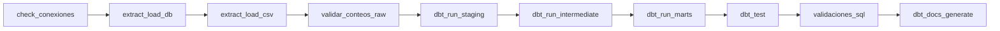

# Proyecto 1 — Flujo moderno de datos SG-Food
### Seminario de Sistemas 2 · USAC · Python + Apache Airflow + dbt + PostgreSQL (Docker Compose)

## 1. Integrantes

| Nombre | Carné |
|---|---|
| [NOMBRE - CARNÉ] | [CARNÉ] |
| [NOMBRE - CARNÉ] | [CARNÉ] |

## 2. Problema y objetivo

**Empresa ficticia:** SG-Food, distribuidora de productos de diversas marcas y categorías,
con 6 sucursales, 80 productos, 250 clientes y ventas entre enero y agosto de 2026.

**Problema:** los procesos son manuales y sin trazabilidad: no hay pruebas de calidad,
los reportes se consultan directo sobre la BD transaccional (que además falla ante
datos sucios) y nadie sabe cuándo ni desde dónde se cargó cada dato.

**Objetivo:** un pipeline ELT reproducible que analice ventas e inventarios:
extracción y carga con Python al schema `raw`, transformación y pruebas con dbt
(`staging` → `intermediate` → `marts`) y orquestación completa con Airflow.

## 3. Arquitectura general

```mermaid
flowchart LR
    subgraph Fuentes
        OLTP[(oltp_sgfood<br/>7 tablas)]
        CSV[(5 CSV<br/>+ BOM)]
    end
    subgraph ELT["ELT orquestado por Airflow (sgfood_elt)"]
        PY[scripts Python<br/>extract_load_db/csv<br/>TRUNCATE + LOAD]
        RAW[(raw<br/>12 tablas + _loaded_at/_source)]
        STG[dbt staging<br/>12 stg_* views]
        INT[dbt intermediate<br/>3 int_* views]
        MART[dbt marts<br/>4 dim_* + 4 fact_* tables]
        TEST{(dbt test<br/>+ validaciones.sql)}
    end
    OLTP --> PY
    CSV --> PY
    PY --> RAW
    RAW --> STG --> INT --> MART --> TEST
```

Todo corre con `docker compose`: un contenedor `postgres:15` con dos bases
(`airflow` = metadata de Airflow, `sgfood` = OLTP fuente + DW), Airflow
(webserver + scheduler, `LocalExecutor`) y un contenedor CLI de dbt.
La imagen de Airflow se construye con `dbt-postgres` incluido
(`Dockerfile.airflow` + `requirements.txt`).

## 4. Extracción y carga (scripts Python)

| Script | Origen → destino | Estrategia |
|---|---|---|
| `scripts/extract_load_db.py` | `oltp_sgfood` (7 tablas) → `raw` | `TRUNCATE + INSERT-SELECT` por tabla, limpieza mínima (`TRIM`, `''→NULL`, `CAST`) |
| `scripts/extract_load_csv.py` | 5 CSV → `raw` (`utf-8-sig` por BOM) | validación de columnas exactas *antes* de tocar la DB + `TRUNCATE + INSERT` por lotes |
| `scripts/verify_counts.py` | conteos fuente vs `raw` | exit 1 ante cualquier diferencia |

Reglas comunes: configuración **solo por entorno** (sin credenciales; override
para host con `PGHOST/PGPORT/PGUSER/PGPASSWORD/PGDATABASE`), logging con hora,
una transacción por tabla/archivo con rollback parcial, **exit 1** ante fallos
(Airflow lo detecta) y `--dry-run` para validar sin DB. `TRUNCATE+LOAD` se eligió
por idempotencia total con fuentes pequeñas (máx. ~3.8k filas) y recarga determinista.
No se cargan `casos_calidad_opcionales.csv` (lista de casos para los tests dbt) ni el
`.xlsx` (catálogo descriptivo de fuentes, no datos).

## 5. DAG de Airflow (`sgfood_elt`)

Secuencia lineal de 10 tareas (ver `dags/sgfood_elt_dag.py`):



- `check_conexiones` (PythonOperator): valida env mínima + `SELECT 1` al warehouse.
- Extracción/carga/conteos (BashOperator) con los scripts y `--data-dir /opt/airflow/raw-data`.
- dbt por capa con selector FQN (`dbt run --select staging|intermediate|marts`), luego `dbt test`.
- `validaciones_sql` corre `sql/validaciones.sql` con `psql -v ON_ERROR_STOP=1`:
  los bloques `DO ... RAISE EXCEPTION` ante huérfanos/duplicados/nulos hacen que
  psql salga ≠ 0 y la tarea quede **en rojo**.
- `default_args`: `retries=2`, `retry_delay=5min`, `on_failure_callback` con log
  (dag/tarea/run), `max_active_runs=1`; `schedule` parametrizable vía
  `SGFOOD_SCHEDULE` (default `@daily`), `catchup=False`. El DAG nace pausado y se
  dispara manual (ver `evidencias/CHECKLIST.md`).
- `dags/dbt_build.py` es un DAG auxiliar de desarrollo (`dbt debug` → `dbt build`).

## 6. Modelo del Data Warehouse

Esquema estrella en la base `sgfood`, schemas `raw` / `staging` (+ `intermediate`
autocreado por dbt) / `marts`. Diagrama completo y justificación en
[`docs/diseno_dw.md`](docs/diseno_dw.md); DDL en [`sql/ddl_dw.sql`](sql/ddl_dw.sql).

| Tabla | Grano | Clave |
|---|---|---|
| `fact_ventas` | línea de `venta_detalle` (3209) | `id_detalle` natural; `id_venta` degenerada |
| `fact_inventario` | corte × sucursal × producto (foto periódica) | compuesta |
| `fact_devoluciones` | una devolución (sucursal vía venta) | `id_devolucion` natural |
| `fact_metas` | mes (día 1) × sucursal | compuesta |
| `dim_fecha/producto/cliente/sucursal` | una fila por entidad | surrogate entero, SCD tipo 1 |

`dim_producto` va desnormalizada (categoría/marca como columnas);
`dim_fecha` se genera con `generate_series` y mes en español sin depender del locale;
`fact_ventas.subtotal` usa el subtotal **recalculado** (regla auditada por test singular).

## 7. Proyecto dbt (`dbt/`)

- **Capas y materializaciones** (`dbt_project.yml`): `staging` = views (12 `stg_*`,
  uno por fuente, con `source()` + casteo/limpieza), `intermediate` = views
  (3 `int_*` con joins y reglas vía `ref()`), `marts` = tables (4 `dim_*` + 4 `fact_*`).
  `macros/generate_schema_name.sql` mapea cada capa a su schema.
- **Sources** (`models/staging/sources.yml`): las 12 tablas de `raw` con `freshness`
  sobre `_loaded_at` (warn 48h / error 720h). Conexión 100% por `env_var` del `.env`
  (`dbt/profiles.yml`, perfil `sgfood`, target `dev`).
- **Tests**: `unique`/`not_null` en claves, `relationships` hecho→dimensión,
  `accepted_values` con valores reales (canal, pago, estado, tipo cliente, unidad,
  motivo) y 2 **singulares** ligados a `casos_calidad_opcionales.csv`:
  `assert_subtotal_consistente` y `assert_devolucion_no_excede_venta`.
- **Docs**: descripciones en cada `schema.yml`; ver con
  `docker compose exec dbt dbt docs generate --project-dir /usr/app`
  (y `dbt docs serve ... --port 8081`).
- Comandos: `docker compose exec dbt dbt build --project-dir /usr/app`
  (también `debug`, `run`, `test` por separado).

## 8. Justificación de decisiones de diseño

1. **OLTP y DW en el mismo contenedor Postgres** (schemas separados, no servicio
   aparte): simple, menos RAM, suficiente para el curso; la separación lógica
   (`oltp_sgfood` vs `raw/staging/marts`) cumple el enunciado.
2. **`raw` sin constraints**: debe aceptar datos sucios sin perder filas; la calidad
   se impone con tests dbt en staging (si `raw` rechazara, se pierde trazabilidad).
3. **Español + prefijos dbt** (`stg_/int_/dim_/fact_`): identificadores iguales a la
   fuente (cero traducción, menos errores) con convención estándar dbt.
4. **Devoluciones como fact propia** (no resta directa): conserva el `motivo` y
   permite análisis de causas; la venta neta se deriva en consumo.
5. **Inventario como foto periódica**: el CSV trae cortes, no eventos; los flags
   `stock_bajo`/`vencido` se precalculan para reporte directo.
6. **Scripts sin `psycopg2` al importar** (import diferido): `--help`/`--dry-run`
   funcionan sin la librería; solo la carga real la exige.
7. **`.env` commiteado a propósito** (proyecto de curso, valores locales) con su
   `.env.example`; `AIRFLOW_UID=1000` evita archivos root en `logs/`/`dags/`.

## 9. Validación y resultados esperados

- `scripts/verify_counts.py`: OLTP (1200 ventas, 3209 líneas, 6 sucursales,
  8 categorías, 10 marcas, 80 productos, 250 clientes) y CSV
  (3840/80/48/30/103 filas) coinciden 1:1 con `raw`.
- `dbt build`: 23 modelos en verde, 0 tests fallidos (incluye 2 singulares + freshness).
- `sql/validaciones.sql`: V1 conteos raw↔marts iguales; V2/V3 en cero (bloque `DO`
  lo garantiza con EXCEPTION); A1–A6 analíticas coherentes:
  ventas por marca×mes y categoría×mes, top-10 productos, stock bajo/vencido del
  último corte, % cumplimiento de metas por mes×sucursal y devoluciones por motivo.

## 10. Manual de implementación paso a paso

**Prerrequisitos:** Docker + plugin Compose, 4 GB RAM libres, puertos 5432 y 8080
libres, usuario en el grupo `docker` (si `docker ps` da permiso denegado:
`sudo usermod -aG docker $USER` y re-login).

> **Windows:** clonar dentro de WSL2 con Docker Desktop (backend WSL2).
> `AIRFLOW_UID` se deja por defecto (el problema de propiedad de archivos no
> aplica: WSL2 virtualiza el dueño). Si algún contenedor falla al arrancar con
> `bad interpreter` o `permission denied`, verificar fin de línea LF
> (ver `.gitattributes`) y `chmod +x scripts/entrypoint-airflow.sh init-db/*.sh`.

```bash
git clone <repo> && cd Proyecto1
cp .env.example .env            # ajustar passwords/claves si se desea
docker compose build            # imagen Airflow + dbt (1ª vez / al cambiar requirements)
docker compose up airflow-init  # migra metadata y crea el admin (solo 1ª vez)
docker compose up -d            # levanta todo
docker compose exec -T postgres psql -U airflow -d sgfood < sql/ddl_dw.sql
set -a; source .env; set +a
docker compose exec scheduler python3 /opt/airflow/scripts/extract_load_db.py
docker compose exec scheduler python3 /opt/airflow/scripts/extract_load_csv.py --data-dir /opt/airflow/raw-data
docker compose exec scheduler python3 /opt/airflow/scripts/verify_counts.py
docker compose exec dbt dbt build --project-dir /usr/app   # o debug/run/test/docs
# UI http://localhost:8080 (AIRFLOW_ADMIN_USER/PASSWORD) → DAG sgfood_elt → Trigger
```

**Variables clave** (`.env`): `POSTGRES_*` + `POSTGRES_WAREHOUSE_DB=sgfood`,
`AIRFLOW_ADMIN_*`, `AIRFLOW_FERNET_KEY` / `AIRFLOW_WEBSERVER_SECRET_KEY`,
`DBT_HOST=postgres` (dentro de contenedores; desde host usar `PGHOST=localhost`
`PGPORT=<POSTGRES_PORT>`), `SGFOOD_SCHEDULE=@daily`, `TZ=America/Guatemala`.

**Troubleshooting:**

| Síntoma | Causa / solución |
|---|---|
| `permission denied` en Docker | usuario fuera del grupo `docker` (ver arriba) |
| `init-db` no crea `sgfood` | el volumen ya existía: crearla a mano (`CREATE DATABASE sgfood;` + cargar el `.sql` vía `/seed-data/`) |
| Tablas `raw` vacías tras el DAG | no se aplicó `ddl_dw.sql`, o los scripts corrieron con otro `PGDATABASE` |
| `dbt debug` falla por host | fuera de Docker exportar `DBT_HOST=localhost DBT_PORT=5432` |
| Archivos root en `logs/` | `AIRFLOW_UID` ≠ `id -u`: igualarlo y `docker compose up -d --force-recreate` (aplica en runtime, sin rebuild) |
| Cambié `requirements.txt` | `docker compose build` + recrear contenedores Airflow |
| DAG en rojo en `validaciones_sql` | leer el log: indica huérfanos/duplicados/nulos (controles V2/V3) |

## 11. Estructura del repositorio y checklist de rúbrica

```
├── README.md  evidencias/CHECKLIST.md  AGENTS.md
├── docker-compose.yml  .env  .env.example  Dockerfile.airflow  requirements.txt
├── sql/ (ddl_dw.sql, validaciones.sql)
├── scripts/ (extract_load_db.py, extract_load_csv.py, verify_counts.py)
├── dags/ (sgfood_elt_dag.py, dbt_build.py)  plugins/  logs/
├── dbt/ (dbt_project.yml, profiles.yml, macros/, models/staging|intermediate|marts, tests/, seeds/)
├── docs/diseno_dw.md  init-db/  raw-data/ (fuentes)
└── evidencias/ (capturas: graph verde, dbt test, validaciones)
```

| Rúbrica | Dónde se cumple |
|---|---|
| Python + Airflow | `scripts/` (3 scripts idempotentes) + `dags/sgfood_elt_dag.py` (10 tareas) |
| Documentación | este README + `docs/` ([diseño](docs/diseno_dw.md), [estructura](docs/estructura_repositorio.md), [variables](docs/variables_entorno.md), [flujo ELT](docs/flujo_elt.md)) + `dbt docs` + `evidencias/` |
| Repo y trabajo en grupo | estructura versionada, `.env.example`, checklist §12 |
| DW y dbt | `sql/ddl_dw.sql` + 23 modelos, 3 capas, tests (incl. singulares) |
| Integración y validación | DAG verde + `verify_counts.py` + `validaciones.sql` (V1–V3, A1–A6) |

## 12. Reflexión

- **Distribución del trabajo:** [COMPLETAR — ej. integrante 1: Fases 1–2 (infra, DDL, scripts); integrante 2: Fases 3–4 (dbt, DAG, validaciones); README conjunto].
- **Áreas de mejora:** [COMPLETAR — ej. SCD tipo 2 en `dim_producto`, incremental en `fact_ventas`, `promociones`/`proveedores` en marts, Metabase/Superset sobre `marts`, CI con `dbt build`].
- **Aprendizajes:** [COMPLETAR — ej. idempotencia con TRUNCATE+LOAD, calidad con tests y no con rejects, secretos por entorno, depuración por capas raw→staging→marts].

## Checklist de entrega

- [ ] Archivos completos en `SS22S2026_#GRUPO/Proyecto1` (reemplazar `#GRUPO`).
- [ ] Placeholders `[NOMBRE - CARNÉ]` y §12 completados.
- [ ] Capturas en `evidencias/` (graph verde, `dbt test`, `validaciones_sql`).
- [ ] Commits de **ambos** integrantes en el historial.
- [ ] Entrega registrada en UEDI.
