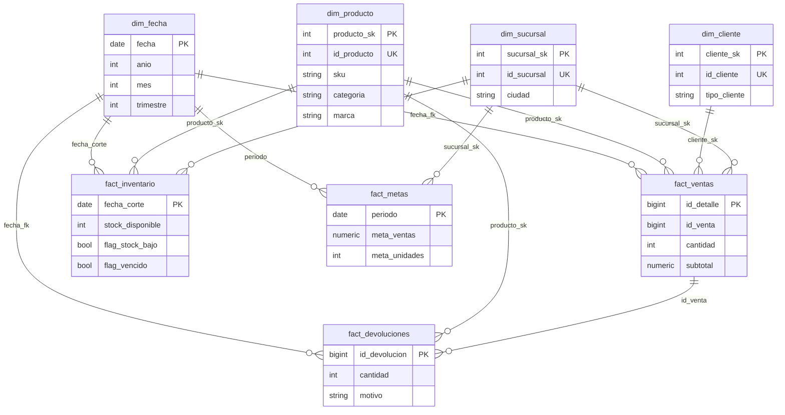

# Diseño del Data Warehouse — SG-Food (Fase 1)

Base de datos `sgfood`. Convención: identificadores en español (como la fuente),
prefijos dbt estándar (`stg_`, `int_`, `dim_`, `fact_`).

## Diagrama estrella (Mermaid)

## Granularidad y claves

| Tabla | Grano | Clave | Relaciones |
|---|---|---|---|
| `fact_ventas` | 1 fila = 1 línea de `venta_detalle` | `id_detalle` (natural) | fecha, producto, cliente, sucursal; `id_venta` degenerada agrupa líneas |
| `fact_inventario` | 1 fila = corte × sucursal × producto (foto periódica) | compuesta `(fecha_corte, sucursal_sk, producto_sk)` | fecha, producto, sucursal |
| `fact_devoluciones` | 1 fila = 1 devolución | `id_devolucion` (natural) | fecha, producto; a ventas vía `id_venta`; sucursal vía venta |
| `fact_metas` | 1 fila = mes × sucursal | compuesta `(periodo, sucursal_sk)`; `periodo` = día 1 del mes | fecha, sucursal |
| `dim_*` | 1 fila = 1 entidad | surrogate `SERIAL` + `UNIQUE` en clave natural | — |
| `dim_fecha` | 1 fila = 1 día calendario | `fecha` (natural) | generada con `generate_series` en dbt |

## Decisiones de diseño (para la documentación)

1. **Surrogates solo en dims de entidad** (`producto_sk`, `cliente_sk`, `sucursal_sk`,
   SCD tipo 1: se sobrescribe, sin historial). Los hechos usan PK naturales o
   compuestas porque sus granos ya son únicos y estables; evita joins
   innecesarios y simplifica las pruebas `relationships`.
2. **`dim_producto` desnormalizada** (categoría y marca como columnas, no
   dims separadas): son jerarquías de 1 nivel con pocos valores; snowflake
   añadiría joins sin valor analítico. Si crecen, se extraen en Fase 3.
3. **`fact_inventario` es foto periódica, no transaccional**: el CSV trae
   cortes mensuales con `lote`/`vencimiento`; no hay eventos de
   entrada/salida. Los flags `flag_stock_bajo`/`flag_vencido` se calculan en
   `marts` para reportes directos de "stock bajo" y rotación.
4. **`devoluciones` como fact propia** (no resta directa en `fact_ventas`):
   conserva el `motivo` (dimensión degenerada útil) y permite análisis de
   causas; la venta neta se calcula en la capa `intermediate`/consulta.
5. **`raw` sin constraints** (ver `sql/ddl_dw.sql`): la calidad se impone con
   tests dbt en staging, no rechazando filas en la carga. Las 10 incidencias de
   `casos_calidad_opcionales.csv` son la lista de casos que los tests deben
   cubrir (Fase 3).
6. **Los CSV con BOM** (`devoluciones`, `metas_ventas`, `promociones`,
   `proveedores_precios`) se leerán con `encoding="utf-8-sig"` en Fase 2.
7. **`promociones` y `proveedores_precios`** aterrizan en `raw` en Fase 2;
   su modelado en marts se decide en Fase 3 (candidatas: join por categoría /
   análisis de costo). No bloquean el estrella de ventas+inventario.
