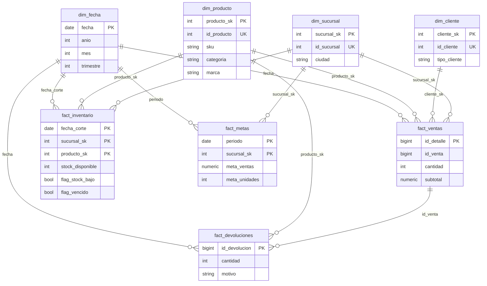

# Diseño del Data Warehouse — SG-Food (Fase 1)

Usamos un **esquema estrella** en la capa `marts` de la base de datos `sgfood`. Lo elegimos porque hace las consultas más rápidas y simples, y funciona bien con herramientas de visualización.

Convención de nombres (dbt): `stg_` para staging, `int_` para intermediate, `dim_` para dimensiones y `fact_` para hechos.

## Diagrama estrella



## Qué representa cada tabla

La **granularidad** es lo que representa cada fila de una tabla.

| Tabla                                       | Qué es una fila                                      | Clave                                                              | Se relaciona con                                                                                |
| ------------------------------------------- | ---------------------------------------------------- | ------------------------------------------------------------------ | ----------------------------------------------------------------------------------------------- |
| **fact_ventas**                             | Una línea de una venta (`venta_detalle`)             | `id_detalle`                                                       | Fecha, Producto, Cliente y Sucursal. Usa `id_venta` para agrupar las líneas de una misma venta. |
| **fact_inventario**                         | Una foto del inventario: fecha × sucursal × producto | Compuesta: `fecha_corte`, `sucursal_sk`, `producto_sk`             | Fecha, Producto y Sucursal.                                                                     |
| **fact_devoluciones**                       | Una devolución                                       | `id_devolucion`                                                    | Fecha y Producto. La sucursal se obtiene desde la venta original (`id_venta`).                  |
| **fact_metas**                              | Una meta mensual de una sucursal                     | Compuesta: `periodo`, `sucursal_sk`                                | Fecha (siempre el día 1 del mes) y Sucursal.                                                    |
| **dim_cliente, dim_producto, dim_sucursal** | Un cliente, producto o sucursal único                | Clave interna (`SERIAL`) y la clave original marcada como `UNIQUE` | —                                                                                               |
| **dim_fecha**                               | Un día del calendario                                | `fecha`                                                            | Se genera con `generate_series` de PostgreSQL dentro de dbt.                                    |

## Cómo llegamos a este diseño

Seguimos tres pasos: primero identificamos **qué procesos del negocio** queríamos medir, luego definimos **qué representa cada fila** de cada proceso, y al final buscamos **qué datos describen** esos procesos.

### Paso 1: Las tablas de hechos (qué queremos medir)

Una tabla de hechos guarda lo que **ocurrió y cuánto**. Creamos una por cada proceso importante del negocio:

| Tabla de hechos       | Proceso                   | Por qué la creamos                                                                      |
| --------------------- | ------------------------- | --------------------------------------------------------------------------------------- |
| **fact_ventas**       | Ventas realizadas         | Para analizar cantidades vendidas y subtotales por producto, cliente, fecha y sucursal. |
| **fact_inventario**   | Existencias de productos  | Para saber cuánto stock había de cada producto, en cada sucursal y en cada fecha.       |
| **fact_devoluciones** | Devoluciones de productos | Para analizar cuánto se devuelve y por qué, sin mezclarlo con las ventas.               |
| **fact_metas**        | Objetivos de venta        | Para comparar las ventas reales contra la meta de cada sucursal por mes.                |

### Paso 2: La granularidad (qué es una fila)

Antes de crear cada tabla decidimos qué representa una fila. Esto es lo más importante, porque evita mezclar niveles de detalle y hace que los cálculos salgan bien.

- En `fact_ventas`, una fila es **una línea de una venta**.
- En `fact_inventario`, una fila es **una foto del inventario** de un producto, en una sucursal y en una fecha.
- En `fact_devoluciones`, una fila es **una devolución**.
- En `fact_metas`, una fila es **la meta de un mes para una sucursal**.

### Paso 3: Las dimensiones (cómo queremos analizar)

Una dimensión guarda el **contexto**: cuándo, dónde, con qué producto y para qué cliente ocurrió algo. Sirven para filtrar y agrupar los hechos.

| Dimensión        | Qué nos permite analizar       |
| ---------------- | ------------------------------ |
| **dim_fecha**    | Por día, mes, trimestre o año. |
| **dim_producto** | Por SKU, categoría o marca.    |
| **dim_cliente**  | Por cliente o tipo de cliente. |
| **dim_sucursal** | Por sucursal o ciudad.         |

Una forma fácil de recordarlo:

> Los **hechos** responden "¿qué pasó y cuánto?". Las **dimensiones** responden "¿cuándo, dónde, con qué producto y para quién?".

Por ejemplo, `fact_ventas` tiene la cantidad y el subtotal, pero para saber cuánto se vendió **por ciudad** o **por categoría** necesitamos `dim_sucursal` y `dim_producto`.

### Por qué un esquema estrella

- Usa pocos `JOIN`: cada hecho se conecta directo con sus dimensiones.
- Las consultas son más simples y rápidas.
- Funciona bien con herramientas de visualización (BI).
- Separa claramente los números (hechos) de las descripciones (dimensiones).
- Es más fácil de entender y mantener que un modelo muy normalizado.

Ejemplo: ventas por ciudad y categoría.

```sql
SELECT
    s.ciudad,
    p.categoria,
    SUM(v.subtotal) AS total_vendido
FROM fact_ventas v
JOIN dim_sucursal s ON v.sucursal_sk = s.sucursal_sk
JOIN dim_producto p ON v.producto_sk = p.producto_sk
GROUP BY s.ciudad, p.categoria;
```

### Por qué separamos las devoluciones

Una devolución es un evento distinto a una venta. Con una tabla propia guardamos el motivo, la cantidad, el producto, la fecha y la venta original. La **venta neta** se calcula después:

```text
venta neta = ventas - devoluciones
```

### Capas del proyecto

Los datos pasan por cuatro capas antes de llegar al modelo final:

- **raw**: los datos tal como llegan de los archivos.
- **staging**: se limpian, se estandarizan y se validan.
- **intermediate**: se hacen cruces y cálculos de negocio.
- **marts**: el modelo estrella final que se usa en los reportes.

Separar las capas ayuda a encontrar errores, saber de dónde viene cada dato y aplicar pruebas de calidad con dbt.

## Decisiones de diseño y por qué

- **Claves internas (surrogate keys) solo en las dimensiones.** Las dimensiones tienen claves propias del warehouse (`producto_sk`, `cliente_sk`) y guardan la clave original como `UNIQUE`. Las dimensiones se actualizan sin guardar historial (SCD Tipo 1). Las tablas de hechos usan sus claves naturales o compuestas, porque ya son únicas y estables. Así el modelo es más simple y es fácil probar las relaciones con `relationships` en dbt.

- **Categoría y marca dentro de `dim_producto`.** No las separamos en otras dimensiones (esquema copo de nieve), porque tienen pocos valores distintos. Separarlas solo agregaría más `JOIN` sin dar ventaja para el análisis.

- **Las devoluciones tienen su propia tabla.** No las restamos de `fact_ventas`, así conservamos el `motivo` de cada devolución y podemos analizar problemas de calidad y sus causas. La venta neta (ventas − devoluciones) se calcula al consultar.

- **El inventario es una foto periódica (periodic snapshot).** Los archivos CSV traen cortes mensuales del stock, no cada entrada y salida. Por eso `fact_inventario` guarda una foto por fecha, sucursal y producto. Las banderas `flag_stock_bajo` y `flag_vencido` se calculan de antemano en `marts` para que los reportes carguen más rápido.

- **La calidad de datos se revisa con dbt, no en `raw`.** La capa `raw` guarda los datos tal como llegan, sin restricciones en la base de datos. Las validaciones (por ejemplo, las de `casos_calidad_opcionales.csv`) se hacen con tests de dbt al pasar por `staging`.
