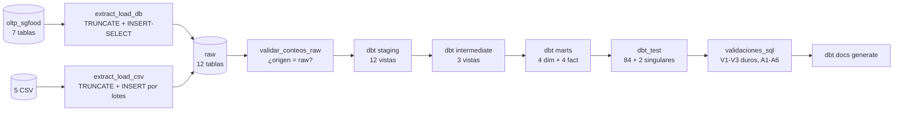

# Flujo ELT y validaciones de la base de datos

El pipeline `sgfood_elt` tiene **10 tareas que se ejecutan una detrás de otra** y se divide en tres etapas:

1. **Extraer y cargar (E-L):** scripts de Python copian los datos a la capa `raw`.
2. **Transformar (T):** dbt limpia y organiza los datos en `staging → intermediate → marts`.
3. **Validar:** `dbt test` y `validaciones.sql` revisan que todo esté correcto.

Todo ocurre en la base `sgfood`. La base `airflow` solo guarda metadata de Airflow y no se toca aquí.

## Vista general



## Las 10 tareas del DAG

| #   | Tarea                  | Etapa             | Qué hace                                                |
| --- | ---------------------- | ----------------- | ------------------------------------------------------- |
| 1   | `check_conexiones`     | Previa            | Revisa las variables de entorno y que la base responda. |
| 2   | `extract_load_db`      | 1. Carga          | Copia las 7 tablas de `oltp_sgfood` a `raw`.            |
| 3   | `extract_load_csv`     | 1. Carga          | Carga los 5 archivos CSV a `raw`.                       |
| 4   | `validar_conteos_raw`  | 1. Carga          | Compara las filas de origen contra las de `raw`.        |
| 5   | `dbt_run_staging`      | 2. Transformación | Crea las vistas limpias.                                |
| 6   | `dbt_run_intermediate` | 2. Transformación | Aplica los cálculos de negocio.                         |
| 7   | `dbt_run_marts`        | 2. Transformación | Construye las dimensiones y los hechos.                 |
| 8   | `dbt_test`             | 3. Validación     | Corre las pruebas de calidad de dbt.                    |
| 9   | `validaciones_sql`     | 3. Validación     | Corre `validaciones.sql` directo en la base.            |
| 10  | `dbt_docs_generate`    | Cierre            | Genera la documentación web del proyecto.               |

---

## Etapa 1: Extracción y carga a `raw`

La carga es **idempotente**: se usa `TRUNCATE + LOAD`, es decir, se vacía la tabla y se vuelve a llenar. Así, si el flujo se ejecuta varias veces, el resultado siempre es el mismo y no se duplican datos.

### `extract_load_db.py`: tablas de la base transaccional

Procesa **una tabla a la vez**, cada una en su propia transacción. Para cada tabla ejecuta algo como esto:

```sql
TRUNCATE TABLE raw.venta;
INSERT INTO raw.venta (id_venta, fecha, ..., _source)
SELECT id_venta,
       CAST(fecha AS DATE)            AS fecha,   -- convierte el tipo
       NULLIF(TRIM(canal::TEXT), '') AS canal,    -- quita espacios; '' pasa a NULL
       ...,
       'oltp_sgfood.venta'                        -- de dónde vino el dato
FROM oltp_sgfood.venta;
```

- La columna `_source` guarda el origen de cada fila, para poder rastrearla.
- Si un valor no se puede convertir, **solo esa tabla** se revierte (rollback) y se registra el error. Las demás tablas siguen cargándose.
- Si alguna tabla falló, el script termina con error (exit 1) al final.
- Volúmenes reales (7 tablas): 6, 8, 10, 80, 250, 1200 y 3209 filas.

### `extract_load_csv.py`: archivos CSV

1. Lee cada archivo con codificación `utf-8-sig`.
2. **Antes de conectarse a la base**, valida que las columnas sean exactamente las esperadas (el contrato `ARCHIVOS`).
3. Limpia los datos: quita espacios y convierte textos vacíos en `NULL`.
4. Inserta por lotes con `execute_values` y guarda `_source = '<archivo>.csv'`.

Volúmenes reales (5 archivos): 3840, 80, 48, 30 y 103 filas.

### `verify_counts.py`: tarea `validar_conteos_raw`

Hace 12 comparaciones:

- Tablas de origen contra `raw`: `oltp_sgfood.* = raw.*`
- Líneas de cada CSV contra `raw`: `lineas_csv = raw.*`

Si hay **cualquier diferencia**, termina con error (exit 1) y la tarea sale en rojo.

---

## Etapa 2: Transformación con dbt (23 modelos)

| Capa                 | Tipo   | Qué hace                                                                      | Ejemplo                                                                                                                       |
| -------------------- | ------ | ----------------------------------------------------------------------------- | ----------------------------------------------------------------------------------------------------------------------------- |
| **staging** (12)     | Vistas | Copia de `raw` con los tipos de datos correctos. Lee de `source('raw', ...)`. | `stg_venta` convierte `id_venta::bigint` y `fecha::date`, y limpia `canal`, `metodo_pago` y `estado` con `nullif(trim(...))`. |
| **intermediate** (3) | Vistas | Cruza tablas y calcula reglas de negocio. Lee con `ref()`.                    | Ver la lista de abajo.                                                                                                        |
| **marts** (8)        | Tablas | El modelo estrella final: 4 dimensiones y 4 hechos.                           | Ver la lista de abajo.                                                                                                        |

**Detalle de `staging`:** `stg_metas_ventas` deja `periodo` como texto `YYYY-MM`. Se convierte a fecha en `marts`.

**Detalle de `intermediate`:**

- `int_ventas_detalle`: une detalle, venta, producto, categoría y marca. Calcula el subtotal:
  `round(cantidad * precio_unitario * (1 - descuento), 2) AS subtotal_calculado`
- `int_inventario_estado`: agrega tres columnas:
  - `flag_stock_bajo`: `disponible < minimo`
  - `flag_vencido`: `vencimiento < corte`
  - `dias_para_vencer`
- `int_devoluciones`: trae el `id_sucursal` desde la venta original, porque el CSV de devoluciones no lo incluye.

**Detalle de `marts`:**

- `dim_fecha`: se genera con `generate_series(min, max)` usando las fechas de los hechos.
- Dimensiones de entidad: la clave interna es `row_number() OVER (ORDER BY id_natural)` (SCD Tipo 1).
- `fact_ventas.subtotal`: usa el subtotal **calculado**, no el que viene en la fuente.
- `fact_metas.periodo`: `date_trunc('month', to_date(periodo, 'YYYY-MM'))`.

---

## Etapa 3: Validaciones

Las validaciones se hacen en **dos niveles**:

| Nivel                | Dónde está                                                   | Tarea del DAG      | Cómo se escribe                                    |
| -------------------- | ------------------------------------------------------------ | ------------------ | -------------------------------------------------- |
| **Pruebas de dbt**   | Archivos `schema.yml` de `staging`, `intermediate` y `marts` | `dbt_test`         | En YAML (dbt genera el SQL solo).                  |
| **Validaciones SQL** | `sql/validaciones.sql`                                       | `validaciones_sql` | SQL escrito a mano, específico para este proyecto. |

### 3.1 Pruebas de dbt (`dbt_test`)

Las pruebas se escriben en YAML, pero dbt las convierte en consultas SQL por dentro. La regla es siempre la misma:

> - Si la consulta **no devuelve filas**, la prueba **pasa**.
> - Si devuelve **una o más filas**, la prueba **falla** (esas filas son los registros con problema).

| Prueba                 | Qué revisa                                                 | Dónde se usa                            |
| ---------------------- | ---------------------------------------------------------- | --------------------------------------- |
| `unique`               | Que no haya valores repetidos.                             | Columnas que son claves.                |
| `not_null`             | Que una columna obligatoria no tenga vacíos.               | Claves y columnas importantes.          |
| `accepted_values`      | Que la columna solo tenga valores permitidos.              | Estados, canales, métodos de pago, etc. |
| `relationships`        | Que cada hecho apunte a una dimensión que existe.          | Hechos → dimensiones.                   |
| `freshness`            | Que los datos de las fuentes (sources) estén actualizados. | Fuentes de `raw`.                       |
| Pruebas singulares (2) | Consultas propias del proyecto.                            | Si devuelven 0 filas, pasan.            |

#### `unique`: sin repetidos

Se usa en columnas que funcionan como clave: `id_producto`, `id_cliente`, `id_sucursal`, `id_venta`, `id_detalle`, `producto_sk`, `cliente_sk` y `sucursal_sk`.

Equivale a esta consulta (si no devuelve filas, la columna es única):

```sql
SELECT id_producto
FROM stg_producto
GROUP BY id_producto
HAVING COUNT(*) > 1;
```

#### `not_null`: sin vacíos

Equivale a buscar filas con `NULL`:

```sql
SELECT *
FROM fact_ventas
WHERE producto_sk IS NULL;
```

En `fact_ventas` se aplica a: `id_detalle`, `fecha_fk`, `producto_sk`, `cliente_sk`, `sucursal_sk` y `subtotal`.

#### `accepted_values`: solo valores permitidos

Por ejemplo, el estado de una venta solo puede ser `ANULADA`, `COMPLETADA` o `PENDIENTE`:

```sql
SELECT *
FROM stg_venta
WHERE estado NOT IN ('ANULADA', 'COMPLETADA', 'PENDIENTE');
```

También se usa en canales de venta, métodos de pago, tipos de cliente, unidades de medida y motivos de devolución.

#### `relationships`: que existan las dimensiones

Revisa que no haya **registros huérfanos**, es decir, hechos que apuntan a una dimensión que no existe:

```sql
SELECT f.producto_sk
FROM fact_ventas f
LEFT JOIN dim_producto p
  ON p.producto_sk = f.producto_sk
WHERE p.producto_sk IS NULL;
```

Relaciones que se prueban en el proyecto:

| Hecho                         | Dimensión                  |
| ----------------------------- | -------------------------- |
| `fact_ventas.producto_sk`     | `dim_producto.producto_sk` |
| `fact_ventas.cliente_sk`      | `dim_cliente.cliente_sk`   |
| `fact_ventas.sucursal_sk`     | `dim_sucursal.sucursal_sk` |
| `fact_ventas.fecha_fk`        | `dim_fecha.fecha`          |
| `fact_inventario.producto_sk` | `dim_producto.producto_sk` |
| `fact_inventario.sucursal_sk` | `dim_sucursal.sucursal_sk` |
| `fact_inventario.fecha_corte` | `dim_fecha.fecha`          |
| `fact_metas.sucursal_sk`      | `dim_sucursal.sucursal_sk` |
| `fact_metas.periodo`          | `dim_fecha.fecha`          |

### 3.2 Validaciones SQL (`sql/validaciones.sql`)

Aquí están los controles hechos a mano para este proyecto. Los códigos son **etiquetas propias** para ordenar el archivo (no son nombres de dbt):

- **V** = validación (revisa que el modelo esté bien construido).
- **A** = analítica (revisa que el modelo sirva para responder preguntas del negocio).

| Bloque                    | Qué responde                                                     |
| ------------------------- | ---------------------------------------------------------------- |
| **V1** Conteos            | ¿Se perdió o se duplicó información al pasar de `raw` a `marts`? |
| **V2** Huérfanos          | ¿Todos los hechos apuntan a dimensiones válidas?                 |
| **V3** Duplicados y nulos | ¿Las claves son únicas y están completas?                        |
| **Bloque `DO`**           | ¿Hay errores graves que deban detener el pipeline?               |
| **A1 a A6**               | ¿El modelo responde bien preguntas reales del negocio?           |

#### V1: comparación de conteos entre `raw` y `marts`

Compara cuántas filas entraron contra cuántas quedaron. Son 4 controles:

| Control            | Compara                                                      | Esperado    |
| ------------------ | ------------------------------------------------------------ | ----------- |
| `V1a_venta`        | `raw.venta` contra las ventas **distintas** de `fact_ventas` | 1200 / 1200 |
| `V1b_detalle`      | `raw.venta_detalle` contra `fact_ventas`                     | 3209 / 3209 |
| `V1c_inventario`   | `raw.inventario_bodega` contra `fact_inventario`             | 3840 / 3840 |
| `V1d_devoluciones` | `raw.devoluciones` contra `fact_devoluciones`                | 80 / 80     |

```sql
SELECT 'V1a_venta' AS control,
       (SELECT count(*) FROM raw.venta) AS en_raw,
       (SELECT count(DISTINCT id_venta) FROM fact_ventas) AS en_marts;
```

**¿Por qué `DISTINCT` en `V1a`?** Porque `fact_ventas` tiene una fila por **línea** de venta, no por venta. Una venta con tres productos genera tres filas, pero sigue siendo una sola venta. En `V1b` no hace falta, porque ahí sí se compara línea contra línea.

Esta validación es **informativa**: muestra los conteos y sirve como evidencia de que no se perdió información.

#### V2: registros huérfanos

Busca hechos que apuntan a una dimensión que no existe. Por ejemplo, una venta con `producto_sk = 25` cuando no existe ese producto en `dim_producto`.

Usa `NOT EXISTS` por cada dimensión, unidos con `OR`: un hecho es huérfano si **falla cualquiera** de sus relaciones.

| Control                      | Revisa                                                                                |
| ---------------------------- | ------------------------------------------------------------------------------------- |
| `V2a_ventas_huerfanas`       | Que cada venta tenga producto, cliente, sucursal y fecha existentes.                  |
| `V2b_inventario_huerfano`    | Que cada registro de inventario tenga producto, sucursal y fecha de corte existentes. |
| `V2c_devoluciones_huerfanas` | Que cada devolución tenga producto y fecha existentes.                                |

```sql
SELECT 'V2a_ventas_huerfanas' AS control,
       count(*) AS filas
FROM fact_ventas f
WHERE NOT EXISTS (SELECT 1 FROM dim_producto p WHERE p.producto_sk = f.producto_sk)
   OR NOT EXISTS (SELECT 1 FROM dim_cliente  c WHERE c.cliente_sk  = f.cliente_sk)
   OR NOT EXISTS (SELECT 1 FROM dim_sucursal s WHERE s.sucursal_sk = f.sucursal_sk)
   OR NOT EXISTS (SELECT 1 FROM dim_fecha    d WHERE d.fecha       = f.fecha_fk);
```

**Resultado esperado: `0` en los tres controles.**

#### V3: duplicados y valores nulos

| Control                   | Revisa                                                                                                                 | Cómo                                  |
| ------------------------- | ---------------------------------------------------------------------------------------------------------------------- | ------------------------------------- |
| `V3a_dup_fact_ventas`     | Que `id_detalle` no se repita en `fact_ventas`.                                                                        | `GROUP BY` + `HAVING count(*) > 1`    |
| `V3b_nulos_claves_ventas` | Que las claves de `fact_ventas` no estén vacías: `id_detalle`, `fecha_fk`, `producto_sk`, `cliente_sk`, `sucursal_sk`. | Cadena de `IS NULL` con `OR`          |
| `V3c_dup_dims`            | Que las claves de `dim_producto`, `dim_cliente` y `dim_sucursal` no se repitan.                                        | Tres consultas unidas con `UNION ALL` |
| `V3d_dup_inventario`      | Que no se repita la clave compuesta de `fact_inventario` (`fecha_corte`, `sucursal_sk`, `producto_sk`).                | `GROUP BY` con las 3 columnas         |

```sql
SELECT 'V3a_dup_fact_ventas' AS control,
       count(*) AS filas
FROM (
    SELECT id_detalle
    FROM fact_ventas
    GROUP BY id_detalle
    HAVING count(*) > 1
) t;
```

**Resultado esperado: `0` en los cuatro controles.**

#### Bloque `DO`: el control duro

Después de V2 y V3 se ejecuta un bloque `DO` de PostgreSQL. Repite los 4 controles más importantes y suma los errores en una variable `n`:

1. Huérfanos en `fact_ventas`.
2. Huérfanos en `fact_inventario`.
3. Duplicados en `fact_ventas`.
4. Nulos en las claves de `fact_ventas`.

```sql
DO $$
DECLARE
    n integer;
BEGIN
    ...
    IF n > 0 THEN
        RAISE EXCEPTION 'VALIDACION FALLIDA';
    END IF;
END $$;
```

Así se convierte en un fallo real del pipeline:

1. El archivo se ejecuta con `psql -v ON_ERROR_STOP=1 -f sql/validaciones.sql`.
2. `ON_ERROR_STOP=1` hace que `psql` se detenga en cuanto hay un error.
3. Si `n > 0`, el bloque lanza `RAISE EXCEPTION` y `psql` termina con un código distinto de 0.
4. Airflow ve ese código, marca `validaciones_sql` **en rojo** y detiene el flujo.

Si todo está bien, el log muestra `NOTICE: Controles duros OK`.

#### A1 a A6: consultas analíticas

No detienen el pipeline. Sirven para demostrar que el Data Warehouse responde preguntas reales y que los datos tienen sentido para los reportes.

| Consulta | Pregunta que responde                              | Cómo funciona                                                                         |
| -------- | -------------------------------------------------- | ------------------------------------------------------------------------------------- |
| **A1**   | ¿Cuánto se vende por marca y mes?                  | `fact_ventas` + `dim_fecha` + `dim_producto`; suma `subtotal` y `cantidad`.           |
| **A2**   | ¿Cuánto se vende por categoría y mes?              | Igual que A1, pero agrupa por categoría.                                              |
| **A3**   | ¿Cuáles son los 10 productos que más venden?       | Suma `subtotal` por producto, ordena de mayor a menor y usa `LIMIT 10`.               |
| **A4**   | ¿Qué productos tienen stock bajo o están vencidos? | Toma la última foto (`max(fecha_corte)`) y filtra `flag_stock_bajo OR flag_vencido`.  |
| **A5**   | ¿Se cumplieron las metas de venta?                 | Compara `fact_metas` contra las ventas reales del mes y calcula el % de cumplimiento. |
| **A6**   | ¿Por qué se devuelven los productos?               | Agrupa `fact_devoluciones` por `motivo` y cuenta devoluciones y unidades.             |

**Regla común de A1 a A3:** solo cuentan las ventas con `estado = 'COMPLETADA'`. Las `ANULADA` y `PENDIENTE` se guardan en el DW por trazabilidad, pero no son ventas reales.

Ejemplo (A1):

```sql
SELECT 'A1_ventas_marca_mes' AS consulta,
       f.nombre_mes,
       f.anio,
       p.marca,
       sum(v.subtotal) AS venta_total,
       sum(v.cantidad) AS unidades
FROM fact_ventas v
JOIN dim_fecha f    ON f.fecha = v.fecha_fk
JOIN dim_producto p ON p.producto_sk = v.producto_sk
WHERE v.estado = 'COMPLETADA'
GROUP BY 1, 2, 3, 4
ORDER BY 2, 3, 5 DESC;
```

**Detalles de A5:**

- Fórmula: `% cumplimiento = 100 × venta real ÷ meta de ventas`
- `LEFT JOIN` conserva la meta aunque ese mes no haya ventas.
- `coalesce(venta_real, 0)` convierte en 0 los meses sin ventas.
- `nullif(meta_ventas, 0)` evita dividir entre cero.

```sql
SELECT 'A5_metas_vs_real' AS consulta,
       to_char(m.periodo, 'YYYY-MM') AS periodo,
       s.nombre AS sucursal,
       m.meta_ventas,
       coalesce(r.venta_real, 0) AS venta_real,
       round(100.0 * coalesce(r.venta_real, 0) / nullif(m.meta_ventas, 0), 1) AS pct_cumplimiento
FROM fact_metas m
JOIN dim_sucursal s ON s.sucursal_sk = m.sucursal_sk
LEFT JOIN (
    SELECT date_trunc('month', v.fecha_fk)::date AS periodo,
           v.sucursal_sk,
           sum(v.subtotal) AS venta_real
    FROM fact_ventas v
    WHERE v.estado = 'COMPLETADA'
    GROUP BY 1, 2
) r ON r.periodo = m.periodo AND r.sucursal_sk = m.sucursal_sk
ORDER BY 2, 3;
```

### 3.3 Diferencias entre `dbt test` y `validaciones.sql`

|                           | `dbt test`                                                                            | `validaciones.sql`                                                                            |
| ------------------------- | ------------------------------------------------------------------------------------- | --------------------------------------------------------------------------------------------- |
| **Cómo se escribe**       | En YAML (`schema.yml`); dbt genera el SQL.                                            | SQL escrito a mano.                                                                           |
| **Qué tipo de pruebas**   | Generales y reutilizables (`unique`, `not_null`, `accepted_values`, `relationships`). | Específicas de este proyecto.                                                                 |
| **Qué revisa**            | Columnas, claves y relaciones.                                                        | Conteos entre `raw` y `marts`, huérfanos, duplicados y nulos, además de consultas de negocio. |
| **Cómo se ejecuta**       | Con dbt.                                                                              | Directo en PostgreSQL con `psql`.                                                             |
| **Cómo detiene el flujo** | Falla la prueba.                                                                      | El bloque `DO` lanza una excepción.                                                           |

En resumen: **V1, V2 y V3 comprueban que el modelo esté bien construido**, y **A1 a A6 comprueban que sirva para el negocio**.

### 3.4 Resultados esperados (corrida validada)

- **V1:** los conteos coinciden (1200 / 3209 / 3840 / 80).
- **V2 y V3:** todo en `0`.
- **Bloque `DO`:** muestra `NOTICE: Controles duros OK`.
- **A1 a A6:** devuelven filas coherentes.

### 3.5 Si aparece un `EXCEPTION`

1. Lee el mensaje. Indica si hay filas **huérfanas**, **duplicadas** o **nulas**, y cuántas.
2. Rastrea el problema hacia atrás, capa por capa:

```text
marts → intermediate → staging → raw → fuente
```

Cada capa conserva las claves naturales, así que puedes encontrar de dónde viene el dato con error.
