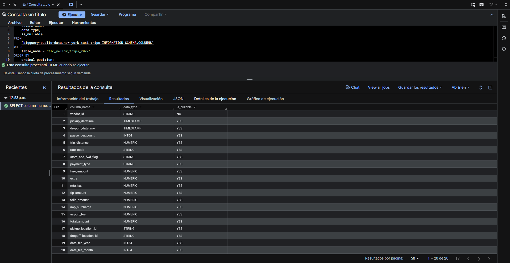
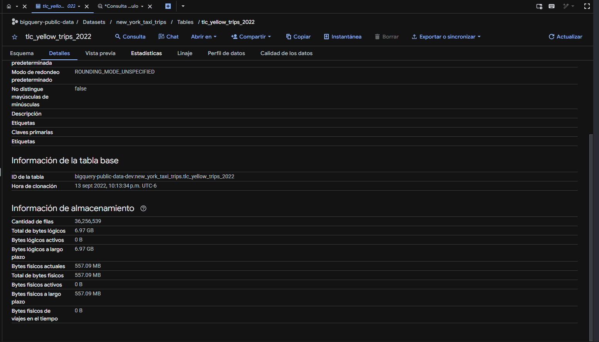
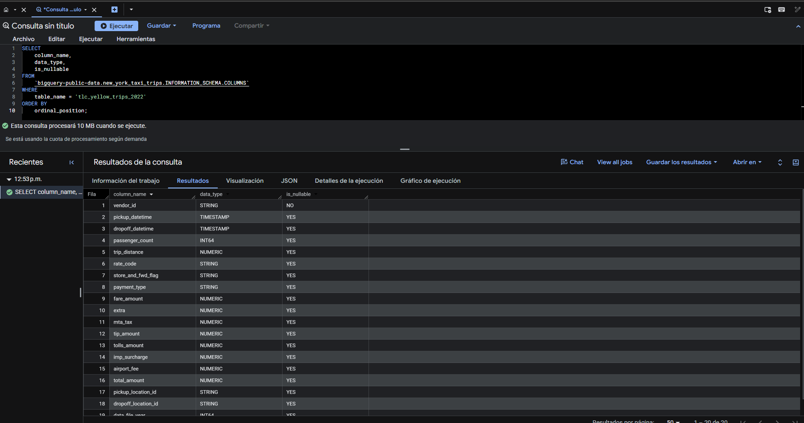
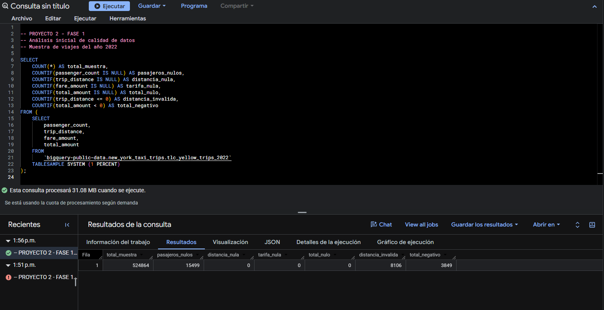
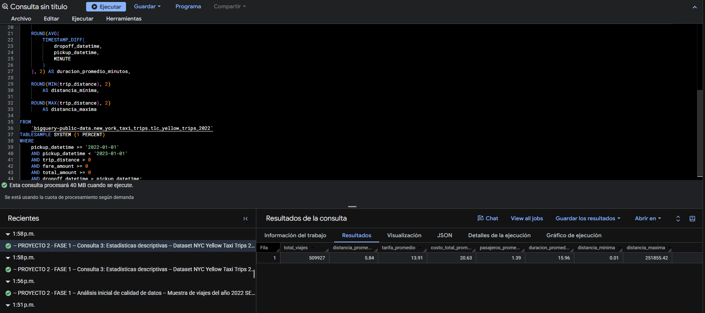
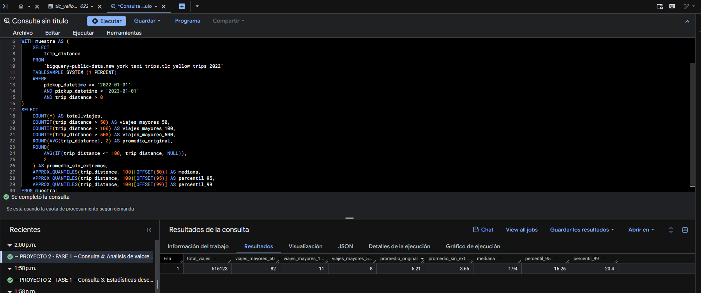

# Fase 1 — Exploración inicial de datos

**Conjunto público:** `bigquery-public-data.new_york_taxi_trips.tlc_yellow_trips_2022`  
**Herramienta:** Google BigQuery (Sandbox, sin facturación habilitada en el proyecto)

## 1. Objetivo

Identificar la estructura, el volumen y las características principales del conjunto de datos *NYC Yellow Taxi Trips 2022*, evaluar problemas iniciales de calidad y obtener estadísticas descriptivas que orienten las transformaciones y optimizaciones posteriores.

## 2. Dataset utilizado

| Característica | Resultado |
|---|---|
| Tabla | `tlc_yellow_trips_2022` |
| Proyecto y dataset | `bigquery-public-data.new_york_taxi_trips` |
| Región de almacenamiento | `US` |
| Columnas | **20** |
| Registros reportados en Detalles | **36,256,539** |
| Tamaño lógico reportado en Detalles | **6.97 GB** |

La cantidad de registros supera el mínimo de **1,000,000** exigido por el enunciado. El conteo y el tamaño se tomaron de la pestaña **Detalles** de la tabla; no de una consulta `COUNT(*)` ejecutada sobre toda la tabla.

**Evidencia de acceso al dataset:**





## 3. Identificación de columnas y tipos de datos

Se consultó `INFORMATION_SCHEMA.COLUMNS` para revisar las 20 columnas, sus tipos y su nulabilidad sin recorrer todos los viajes.

```sql
SELECT
    column_name,
    data_type,
    is_nullable
FROM `bigquery-public-data.new_york_taxi_trips.INFORMATION_SCHEMA.COLUMNS`
WHERE table_name = 'tlc_yellow_trips_2022'
ORDER BY ordinal_position;
```

Algunas variables importantes son:

| Campo | Tipo | Interpretación |
|---|---|---|
| `pickup_datetime` | `TIMESTAMP` | Inicio del viaje |
| `dropoff_datetime` | `TIMESTAMP` | Finalización del viaje |
| `passenger_count` | `INT64` | Número de pasajeros |
| `trip_distance` | `NUMERIC` | Distancia del viaje |
| `fare_amount` | `NUMERIC` | Tarifa base |
| `tip_amount` | `NUMERIC` | Propina |
| `total_amount` | `NUMERIC` | Importe total |
| `payment_type` | `STRING` | Medio de pago |
| `pickup_location_id` | `STRING` | Zona de origen |
| `dropoff_location_id` | `STRING` | Zona de destino |

**Observación:** 19 columnas admiten valores nulos según el esquema; `vendor_id` no. La nulabilidad permitida no equivale a la presencia efectiva de valores nulos.

**Archivo SQL:** [`1_columnas_y_tipos.sql`](../ConsultasBigQuery/ExploracionInicial/1_columnas_y_tipos.sql)

**Evidencia fotográfica:**




## 4. Volumen del dataset y limitación de permisos

Inicialmente se intentó consultar `bigquery-public-data.region-us.INFORMATION_SCHEMA.TABLE_STORAGE` para obtener el conteo y los bytes lógicos. Google BigQuery respondió **Access Denied** por falta de los permisos `bigquery.tables.get` y `bigquery.tables.list` a nivel del proyecto público.

Por ello, se consultaron los metadatos visibles en **Detalles** de la tabla, donde se reportaron **36,256,539 filas** y **6.97 GB** de bytes lógicos.

El error de permisos corresponde al acceso a los metadatos administrativos del proyecto público; no impide consultar las columnas y los datos habilitados para lectura.

**Consulta SQL utilizada (intento con permisos restringidos):**

```sql
-- Consulta de metadatos de almacenamiento (Access Denied)
SELECT
    table_name,
    total_rows AS total_registros,
    ROUND(total_logical_bytes / POW(1024, 3), 2) AS tamano_gib
FROM `bigquery-public-data.region-us.INFORMATION_SCHEMA.TABLE_STORAGE`
WHERE table_schema = 'new_york_taxi_trips'
  AND table_name = 'tlc_yellow_trips_2022'
  AND deleted = FALSE;
```

**Archivo SQL:** [`2_conteo_registros.sql`](../ConsultasBigQuery/ExploracionInicial/2_conteo_registros.sql)

**Evidencia fotográfica:**


> **Importante:** el volumen de 36,256,539 registros se obtuvo de **Detalles**, no del SQL anterior, que falló por permisos.

## 5. Evaluación inicial de calidad de datos

Se analizó una muestra mediante `TABLESAMPLE SYSTEM (1 PERCENT)`, examinando nulos y valores potencialmente inconsistentes.

> `TABLESAMPLE SYSTEM` muestrea bloques físicos, por lo que el 1 % solicitado no significa exactamente el 1 % de filas ni constituye necesariamente una muestra uniforme de registros.

| Indicador | Registros | Porcentaje sobre la muestra |
|---|---:|---:|
| Registros de la muestra | **524,864** | 100 % |
| `passenger_count IS NULL` | 15,499 | 2.95 % |
| `trip_distance IS NULL` | 0 | 0 % |
| `fare_amount IS NULL` | 0 | 0 % |
| `total_amount IS NULL` | 0 | 0 % |
| `trip_distance <= 0` | 8,106 | 1.54 % |
| `total_amount < 0` | 3,849 | 0.73 % |

**Interpretación.** Los pasajeros nulos necesitan tratamiento antes de utilizarlos como característica predictiva. Las distancias no positivas merecen revisión. Los importes negativos pueden corresponder a devoluciones, ajustes o datos anómalos; **no deben descartarse como errores sin investigar su significado**.

**Consulta SQL utilizada:**

```sql
-- Evaluación inicial de calidad en una muestra de bloques
SELECT
    COUNT(*) AS total_muestra,
    COUNTIF(passenger_count IS NULL) AS pasajeros_nulos,
    COUNTIF(trip_distance IS NULL) AS distancia_nula,
    COUNTIF(fare_amount IS NULL) AS tarifa_nula,
    COUNTIF(total_amount IS NULL) AS total_nulo,
    COUNTIF(trip_distance <= 0) AS distancia_invalida,
    COUNTIF(total_amount < 0) AS total_negativo
FROM (
    SELECT passenger_count, trip_distance, fare_amount, total_amount
    FROM `bigquery-public-data.new_york_taxi_trips.tlc_yellow_trips_2022`
    TABLESAMPLE SYSTEM (1 PERCENT)
);
```

**Archivo SQL:** [`3_valores_nulos.sql`](../ConsultasBigQuery/ExploracionInicial/3_valores_nulos.sql)

**Evidencia fotográfica:**



## 6. Estadísticas descriptivas

Se ejecutó una consulta sobre una muestra del 1 % de bloques, filtrando viajes iniciados en 2022, distancias positivas, importes no negativos y fechas de llegada posteriores a las de salida. Los siguientes valores corresponden a la **última ejecución documentada**, mostrada en la captura `4_estadisticas_descriptivas.png`, y **no representan necesariamente a los 36,256,539 viajes**.

| Métrica | Resultado |
|---|---:|
| Viajes analizados después de filtrar | **514,496** |
| Distancia promedio | **6.58 millas** |
| Tarifa promedio (`fare_amount`) | **USD 14.81** |
| Importe total promedio (`total_amount`) | **USD 21.63** |
| Pasajeros promedio | **1.42** |
| Duración promedio | **16.58 minutos** |
| Distancia mínima | **0.01 millas** |
| Distancia máxima | **279,060.17 millas** |

### Interpretación

- **Viajes y pasajeros:** después de los filtros de validez se incluyeron 514,496 viajes. La media de 1.42 pasajeros se calcula sobre los registros con `passenger_count` no nulo; por lo tanto, no corresponde necesariamente a los 514,496 registros.
- **Tarifas:** el importe medio total (USD 21.63) es superior a la tarifa base media (USD 14.81). Esto es compatible con la presencia de propinas, impuestos y otros componentes del costo; la diferencia entre promedios **no demuestra por sí sola** cuánto aporta cada componente.
- **Duración:** el promedio de 16.58 minutos es un resumen de la muestra filtrada. La consulta utiliza `TIMESTAMP_DIFF(..., MINUTE)`, que devuelve minutos enteros por viaje antes de promediarlos.
- **Distancia:** una distancia máxima de **279,060.17 millas** resulta extremadamente improbable para un taxi urbano. Podría ser un registro atípico o un problema de calidad y justifica comprobar percentiles y medias robustas antes de limpiar el dataset.
- **Precaución estadística:** `TABLESAMPLE SYSTEM` selecciona bloques de almacenamiento; distintas ejecuciones pueden devolver tamaños y medias distintos, por lo que no deben combinarse como si fueran una única muestra fija.

### Consulta SQL ejecutada

```sql
-- Consulta 4: Estadísticas descriptivas en viajes filtrados
SELECT
    COUNT(*) AS total_viajes,
    ROUND(AVG(trip_distance), 2) AS distancia_promedio,
    ROUND(AVG(fare_amount), 2) AS tarifa_promedio,
    ROUND(AVG(total_amount), 2) AS costo_total_promedio,
    ROUND(AVG(passenger_count), 2) AS pasajeros_promedio,
    ROUND(AVG(TIMESTAMP_DIFF(dropoff_datetime, pickup_datetime, MINUTE)), 2)
        AS duracion_promedio_minutos,
    ROUND(MIN(trip_distance), 2) AS distancia_minima,
    ROUND(MAX(trip_distance), 2) AS distancia_maxima
FROM `bigquery-public-data.new_york_taxi_trips.tlc_yellow_trips_2022`
TABLESAMPLE SYSTEM (1 PERCENT)
WHERE pickup_datetime >= '2022-01-01'
  AND pickup_datetime < '2023-01-01'
  AND trip_distance > 0
  AND fare_amount >= 0
  AND total_amount >= 0
  AND dropoff_datetime > pickup_datetime;
```

**Archivo SQL:** [`4_estadisticas_descriptivas.sql`](../ConsultasBigQuery/ExploracionInicial/4_estadisticas_descriptivas.sql)

**Evidencia — resultados de estadísticas descriptivas:**



## 7. Análisis de valores atípicos de distancia

Para cuantificar la influencia de distancias inusuales, se ejecutó una consulta sobre otra muestra del 1 % de bloques. Se contaron viajes superiores a 50, 100 y 500 millas y se compararon el promedio general, el promedio excluyendo distancias mayores a 100 millas y los percentiles aproximados.

### Resultados obtenidos

| Indicador | Resultado |
|---|---:|
| Viajes en la muestra con distancia positiva | **516,123** |
| Viajes con distancia > 50 millas | **82** (0.0159 %) |
| Viajes con distancia > 100 millas | **11** (0.0021 %) |
| Viajes con distancia > 500 millas | **8** (0.0016 %) |
| Distancia promedio original | **5.21 millas** |
| Distancia promedio excluyendo > 100 millas | **3.65 millas** |
| Mediana (percentil 50 aproximado) | **1.94 millas** |
| Percentil 95 aproximado | **16.26 millas** |
| Percentil 99 aproximado | **20.40 millas** |

### Interpretación y hallazgos

1. **Los valores extremos tienen gran influencia sobre la media.** Excluir únicamente los viajes con distancia superior a 100 millas reduce el promedio de **5.21 a 3.65 millas**, una disminución de **1.56 millas (aprox. 29.94 %)**. Esto sucede aunque los 11 viajes superiores a 100 millas representan una proporción muy pequeña de la muestra.
2. **La mediana es considerablemente menor que la media.** La mediana aproximada de **1.94 millas**, frente a la media original de **5.21**, indica una distribución muy sesgada hacia valores grandes; unos pocos trayectos largos elevan fuertemente el promedio.
3. **La mayoría de las distancias es mucho menor que los máximos detectados.** Aproximadamente el 95 % de los valores está por debajo o cerca de **16.26 millas** y el 99 % por debajo o cerca de **20.40 millas** (percentiles aproximados de la muestra).
4. **La distancia de 100 millas es un umbral exploratorio, no una regla definitiva.** Antes de excluir registros de las tablas optimizadas o del entrenamiento de ML, conviene contrastar la distancia con duración, tarifa y zonas, y documentar los criterios de filtrado. Los viajes superiores a 500 millas merecen revisión prioritaria.
5. **Las dos capturas proceden de ejecuciones con muestreo por bloques.** La consulta descriptiva tiene 514,496 viajes y esta consulta de atípicos 516,123 porque usan filtros distintos y pueden seleccionar bloques diferentes. **No corresponde comparar directamente sus promedios como si fueran resultados de una misma población filtrada**.

### Consulta SQL ejecutada

```sql
-- Consulta 5: análisis de valores atípicos
WITH muestra AS (
    SELECT trip_distance
    FROM `bigquery-public-data.new_york_taxi_trips.tlc_yellow_trips_2022`
    TABLESAMPLE SYSTEM (1 PERCENT)
    WHERE pickup_datetime >= '2022-01-01'
      AND pickup_datetime < '2023-01-01'
      AND trip_distance > 0
)
SELECT
    COUNT(*) AS total_viajes,
    COUNTIF(trip_distance > 50) AS viajes_mayores_50,
    COUNTIF(trip_distance > 100) AS viajes_mayores_100,
    COUNTIF(trip_distance > 500) AS viajes_mayores_500,
    ROUND(AVG(trip_distance), 2) AS promedio_original,
    ROUND(AVG(IF(trip_distance <= 100, trip_distance, NULL)), 2)
        AS promedio_sin_extremos,
    APPROX_QUANTILES(trip_distance, 100)[OFFSET(50)] AS mediana,
    APPROX_QUANTILES(trip_distance, 100)[OFFSET(95)] AS percentil_95,
    APPROX_QUANTILES(trip_distance, 100)[OFFSET(99)] AS percentil_99
FROM muestra;
```

**Archivo SQL:** [`5_valores_atipicos.sql`](../ConsultasBigQuery/ExploracionInicial/5_valores_atipicos.sql)

**Evidencia — conteos de valores atípicos, promedios y percentiles:**




## 8. Cuotas gratuitas de BigQuery y tamaño del dataset

La tabla pública `bigquery-public-data.new_york_taxi_trips.tlc_yellow_trips_2022` contiene **36,256,539 registros** y muestra un **tamaño lógico de 6.97 GB**, según la pestaña **Detalles** de BigQuery. Esta cifra describe el tamaño de la tabla pública, **no** el consumo de cada consulta ni el espacio utilizado en el proyecto propio.

En BigQuery Sandbox se dispone de las siguientes cuotas, conforme a la documentación oficial de Google Cloud (consulta: octubre de 2026):

| Recurso | Límite en Sandbox | Implicación para el proyecto |
|---|---|---|
| Procesamiento de consultas | **1 TiB por mes** (aprox. 1,024 GiB) | El volumen contabilizado se acumula entre consultas; se debe revisar la estimación de bytes antes de ejecutar cada una. |
| Almacenamiento propio | **10 GiB acumulativos durante la vida útil del Sandbox** | La cuota no se recupera al borrar tablas; conviene crear únicamente subconjuntos derivados necesarios. |
| Vigencia de tablas y vistas | **Caducidad automática a los 60 días** | Es necesario guardar scripts, evidencias y exportaciones importantes. |

**Diferencia esencial:** los **6.97 GB** son el tamaño lógico de la tabla pública; **1 TiB/mes** es la cuota de datos procesados por consultas. No se descuentan 6.97 GB necesariamente en cada ejecución: BigQuery procesa las columnas y bloques que la consulta necesita. Los 10 GiB de almacenamiento Sandbox se refieren a los datos que se almacenan en el propio entorno, no a las tablas públicas que únicamente se consultan.

Por ello, durante la Fase 1 se eligió `TABLESAMPLE SYSTEM (1 PERCENT)` para una exploración ágil y de bajo consumo. En la **Fase 2** se incrementará el volumen analizado y se comparará el rendimiento sobre los **mismos registros**, respetando ambas cuotas.

**Fuentes oficiales:** [Precios de BigQuery](https://cloud.google.com/bigquery/pricing?hl=es-419) · [Limitaciones de BigQuery Sandbox](https://cloud.google.com/bigquery/docs/sandbox).

---

## 9. Consideraciones metodológicas: muestreo y variabilidad

### ¿Por qué se utilizó una muestra del 1 %?

En la **Fase 1 (exploración inicial)** se utilizó `TABLESAMPLE SYSTEM (1 PERCENT)` en las consultas de calidad, estadísticas descriptivas y valores atípicos para **reducir los datos leídos, agilizar las pruebas y cuidar la cuota de procesamiento del entorno BigQuery Sandbox**. El objetivo era conocer las variables y detectar posibles problemas sin tener que recorrer los 36,256,539 registros en cada consulta. El conteo total y tamaño lógico, en cambio, se consultaron en la pestaña **Detalles** de BigQuery, no mediante un muestreo.

`TABLESAMPLE SYSTEM` selecciona **aproximadamente el 1 % de los bloques de almacenamiento**, no un 1 % exacto de las filas. Por ello las muestras pueden contener más o menos registros de lo esperado, y no deben interpretarse como un censo de todos los viajes. El tamaño procesado depende de los bloques y columnas consultadas.

### ¿Por qué pueden cambiar los resultados al volver a ejecutar los scripts?

BigQuery puede escoger **bloques distintos en cada ejecución** de `TABLESAMPLE SYSTEM`, aunque el SQL no cambie. En consecuencia, pueden variar el número de viajes de la muestra, las medias de distancias, tarifas o duraciones, los percentiles y los valores máximos. Las observaciones extremas provocan fluctuaciones particularmente grandes en las medias y los máximos. **Esto es un comportamiento esperado del muestreo, no un error en el script.**

Los resultados cuantitativos presentados en las secciones anteriores corresponden **a las ejecuciones concretas conservadas en las capturas de pantalla**. Una repetición de las consultas podría arrojar cifras diferentes. Además, cada consulta aplica filtros diferentes; por esa razón, tampoco es adecuado tratar todas las muestras como si fueran la misma población de registros.

### ¿Qué cambiará en la Fase 2?

En la **Fase 2 (consultas SQL avanzadas y optimización)** se trabajará con **un volumen considerablemente mayor de datos**, idealmente con un subconjunto de **al menos un millón de registros**, según exige la rúbrica. Se definirán filtros y conjuntos de datos consistentes para medir la diferencia entre tablas y consultas **estándar** y **optimizadas con particiones y clustering**.

La comparación se realizará con **los mismos registros, columnas relevantes, condiciones de filtrado y criterios de medición**; no compararemos resultados obtenidos sobre tamaños de muestra distintos. Antes de crear tablas derivadas se revisarán los límites de almacenamiento del Sandbox y, antes de ejecutar consultas grandes, la estimación de bytes procesados. **No se habilitará facturación** para realizar estas pruebas.

| Etapa | Enfoque de datos |
|---|---|
| Fase 1: exploración | Muestras por bloques del 1 % para reconocimiento inicial |
| Fase 2: SQL avanzado | Dataset completo cuando convenga y sea viable con la cuota gratuita |
| Fase 2: optimización | Mismo conjunto de al menos 1 millón de registros para comparar rendimiento |
| Fase 3: Machine Learning | Subconjunto limpio y reproducible para entrenamiento y evaluación |
| Fase 4: visualizaciones | Resultados agregados y métricas de los modelos |

---

## 10. Conclusiones de la fase

1. Se identificó satisfactoriamente el esquema de 20 columnas y se comprobó que el volumen del dataset supera el millón de registros requerido.
2. Se detectaron valores nulos y condiciones potencialmente inconsistentes que deben considerarse al preparar los datos.
3. Se calcularon indicadores descriptivos de viajes, tarifas, pasajeros y duración sobre una muestra filtrada.
4. Se comprobó que distancias extremas afectan significativamente el promedio: de 5.21 a 3.65 millas al excluir distancias superiores a 100 millas en la muestra de atípicos; el umbral todavía debe validarse antes de aplicar limpieza definitiva.
5. Se documentó una restricción de acceso a metadatos de almacenamiento de un proyecto público y se obtuvo una alternativa mediante la pestaña **Detalles**.


## 11. Siguiente fase

**Fase 2 — Consultas avanzadas, particiones y clustering, comparación de rendimiento de consultas optimizadas:**

- Elaborar consultas por hora, día, mes, ubicación y modalidad de pago.
- Definir reglas de calidad y criterios de exclusión con base en la exploración.
- Crear un subconjunto derivado con el volumen suficiente para cumplir la rúbrica, verificando previamente los límites de almacenamiento del Sandbox.
- Implementar particionado por fecha y clustering por zona de origen/destino.
- Comparar bytes procesados y tiempo de ejecución entre consultas estándar y optimizadas.
- Preparar los datos que posteriormente utilizarán los dos modelos de BigQuery ML exigidos por el proyecto.