# Fase 2 — Consultas avanzadas y optimización en BigQuery

**Dataset público:** `bigquery-public-data.new_york_taxi_trips.tlc_yellow_trips_2022`  
**Proyecto de trabajo:** `project-e2e09e75-7c61-4bba-9a1`  
**Dataset de trabajo:** `optimizacion_taxis`  
**Entorno:** BigQuery Sandbox; facturación del proyecto deshabilitada.

## 1. Objetivo

Realizar consultas SQL analíticas sobre viajes de taxi de Nueva York durante 2022; seleccionar un subconjunto reproducible de más de un millón de registros; crear y validar una tabla de referencia y una tabla con **particionamiento por fecha y clustering por ubicaciones**; y comparar el procesamiento necesario para responder la misma pregunta de negocio. Se documentan también los problemas encontrados durante la creación de particiones con fechas históricas.

## 2. Consultas analíticas sobre el dataset público

A diferencia de la exploración de la Fase 1, aquí **no se utilizó `TABLESAMPLE`**: las consultas abarcan los registros del período que cumplen los filtros. Los valores deberían permanecer estables si los datos de origen no cambian.

### 2.1. Análisis temporal — `1_analisis_temporal.sql`

La consulta agrupa por mes de `pickup_datetime` y calcula cantidad de viajes, distancias, importes y duración promedio. Se aplicaron reglas básicas: `trip_distance > 0`, `trip_distance <= 100`, `total_amount >= 0` y `dropoff_datetime > pickup_datetime`.

Entre los resultados se observaron **2,421,619 viajes válidos en enero**, **3,589,474 en octubre** y **57 en diciembre**. El promedio de costo de septiembre fue **USD 22.72**. El conjunto consultado exhibe cobertura mensual muy desigual, por lo que los patrones de diciembre deben interpretarse con precaución.

**Consulta utilizada:** [`1_analisis_temporal.sql`](../ConsultasBigQuery/Optimizacion/1_analisis_temporal.sql)

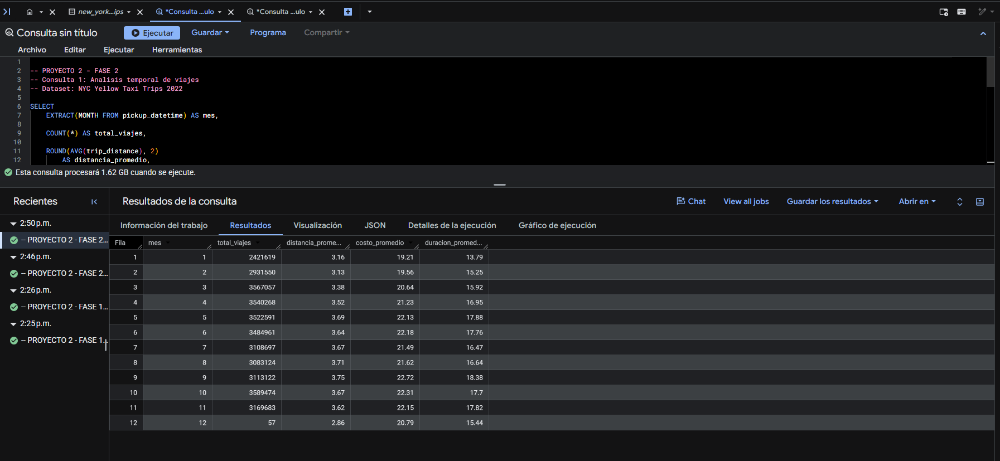

### 2.2. Validación de cobertura temporal — `2_validacion_cobertura_temporal.sql`

Para investigar el resultado de diciembre se repitió el conteo mensual **sin filtros de limpieza**, conservando únicamente el rango de fechas de 2022. Diciembre volvió a presentar **57 viajes**. En consecuencia, esa anomalía **no fue producida por los filtros de limpieza**. No se afirma que en Nueva York solo hayan ocurrido 57 viajes en diciembre; la conclusión se limita a esta tabla pública y al filtro de fecha utilizado.

```sql
SELECT
  EXTRACT(MONTH FROM pickup_datetime) AS mes,
  COUNT(*) AS total_registros
FROM `bigquery-public-data.new_york_taxi_trips.tlc_yellow_trips_2022`
WHERE pickup_datetime >= '2022-01-01'
  AND pickup_datetime < '2023-01-01'
GROUP BY mes
ORDER BY mes;
```

**Script:** [`2_validacion_cobertura_temporal.sql`](../ConsultasBigQuery/Optimizacion/2_validacion_cobertura_temporal.sql)

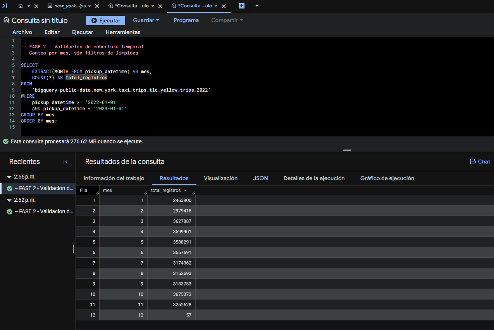

### 2.3. Análisis económico — `3_analisis_economico.sql`

La consulta agrupa los viajes válidos por distancia y calcula las tarifas y propinas promedio.

| Rango de distancia          |     Viajes | Tarifa promedio (USD) | Propina promedio (USD) | Costo total promedio (USD) |
| --------------------------- | ---------: | --------------------: | ---------------------: | -------------------------: |
| Hasta 2 millas              | 18,623,742 |                  7.68 |                   1.68 |                      12.91 |
| Más de 2 y hasta 5 millas   | 10,659,541 |                 14.03 |                   2.62 |                      20.25 |
| Más de 5 y hasta 10 millas  |  3,257,306 |                 25.24 |                   4.38 |                      34.64 |
| Más de 10 y hasta 20 millas |  2,622,808 |                 45.98 |                   7.58 |                      61.61 |
| Más de 20 millas            |    383,991 |                 65.25 |                   9.60 |                      84.23 |

**Interpretación:** predominan los viajes cortos. A medida que aumenta la distancia, también aumentan los importes y propinas medios en términos absolutos. La asociación no demuestra causalidad.

**Script:** [`3_analisis_economico.sql`](../ConsultasBigQuery/Optimizacion/3_analisis_economico.sql)

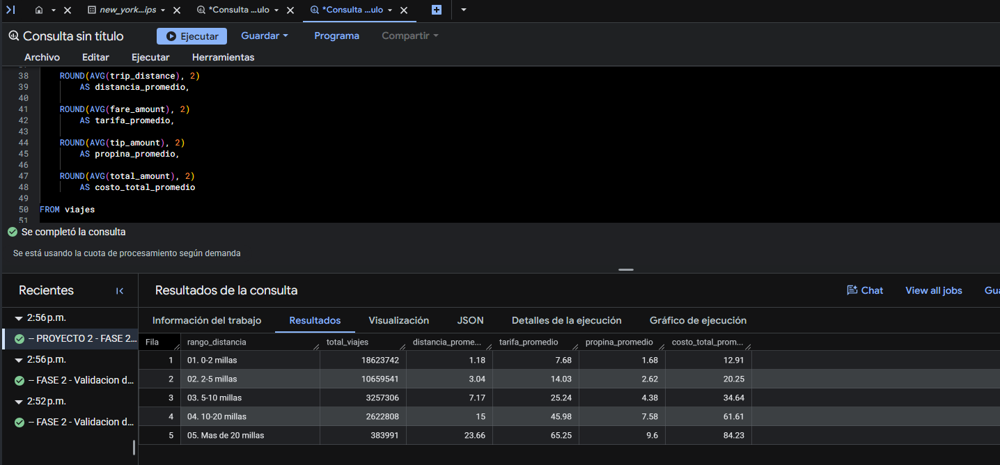

### 2.4. Análisis geográfico — `4_analisis_geografico.sql`

Se identificaron las ubicaciones de origen con mayor volumen de viajes y la variedad de destinos.

| Ubicación de origen |    Viajes | Distancia promedio (millas) | Costo promedio (USD) |
| ------------------- | --------: | --------------------------: | -------------------: |
| 132                 | 1,680,523 |                       16.17 |                61.33 |
| 237                 | 1,678,133 |                        1.92 |                15.65 |
| 236                 | 1,493,524 |                        2.13 |                16.50 |
| 161                 | 1,431,051 |                        2.52 |                18.46 |

**Interpretación:** la ubicación `132` combina gran volumen y distancias medias considerablemente mayores. Estas diferencias hacen útil comparar consultas filtradas por `pickup_location_id`.

**Script:** [`4_analisis_geografico.sql`](../ConsultasBigQuery/Optimizacion/4_analisis_geografico.sql)

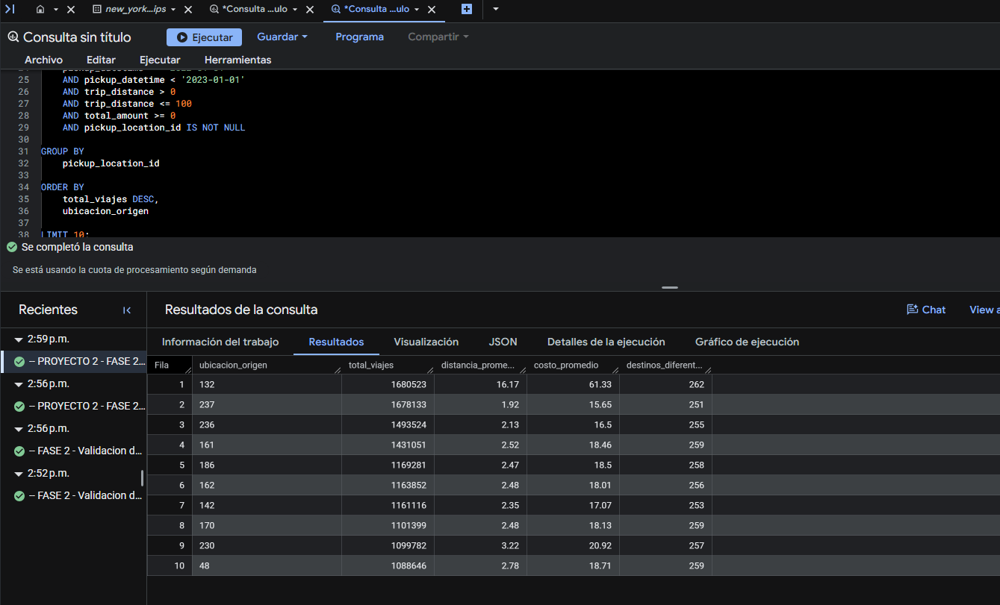

## 3. Validación del subconjunto y creación de tabla base

### 3.1. Selección de enero — `5_validacion_subconjunto.sql`

Se eligieron viajes válidos de **enero de 2022**. El conjunto contiene **2,421,619 registros**, **256 ubicaciones de origen** y **261 de destino**, con **3.16 millas** y **USD 19.21** de promedios de distancia y costo. Supera el mínimo de un millón de registros indicado en la guía.

**Script:** [`5_validacion_subconjunto.sql`](../ConsultasBigQuery/Optimizacion/5_validacion_subconjunto.sql)

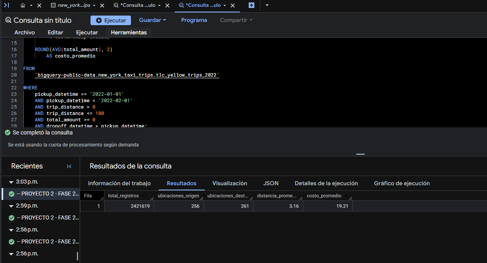

### 3.2. Dataset de trabajo — `6_creacion_dataset.sql`

Se creó el dataset `optimizacion_taxis` en la región `US`, con el fin de separar las tablas experimentales del origen público.

**Script:** [`6_creacion_dataset.sql`](../ConsultasBigQuery/Optimizacion/6_creacion_dataset.sql)

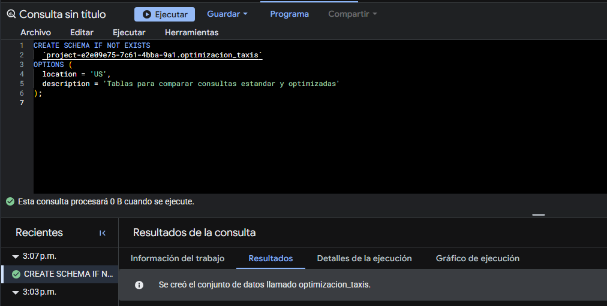

### 3.3. Tabla de referencia sin particiones — `7_creacion_tabla_base.sql`

Se creó `viajes_base` con diez campos analíticos, mediante `CREATE TABLE ... AS SELECT`, sin `PARTITION BY` ni `CLUSTER BY`. El conteo confirmó **2,421,619 registros**.

**Script:** [`7_creacion_tabla_base.sql`](../ConsultasBigQuery/Optimizacion/7_creacion_tabla_base.sql)

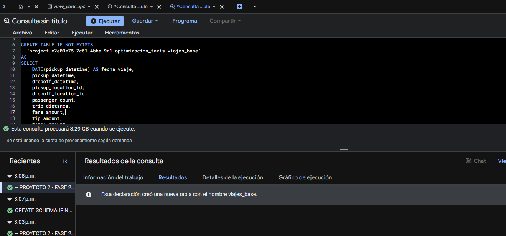

## 4. ¿Qué son particionamiento y clustering?

**Particionamiento por fecha:** divide el almacenamiento de una tabla según valores de una columna `DATE` (en este ejercicio, por día). Si la consulta filtra correctamente la columna de partición, BigQuery puede **descartar las particiones ajenas al intervalo solicitado**, reduciendo bytes leídos (*partition pruning*).

**Clustering por ubicaciones:** organiza los bloques de almacenamiento dentro de la tabla o partición utilizando, en orden, `pickup_location_id` y `dropoff_location_id`. Una consulta que filtra estos campos puede leer menos bloques mediante *block pruning*. No se trata de una clasificación visible de filas ni garantiza idéntico ahorro en cualquier consulta.

**Uso conjunto:** para una búsqueda de viajes de ciertos días y de una ubicación concreta, BigQuery puede aprovechar primero la poda de particiones y después la poda de bloques. El efecto real debe medirse: depende de la selectividad de los filtros y del tamaño de los bloques.

## 5. Incidencias y solución en BigQuery Sandbox

### 5.1. Primera creación optimizada — `8_creacion_tabla_optimizada.sql`

Se creó `viajes_optimizados` con `PARTITION BY fecha_viaje` y `CLUSTER BY pickup_location_id, dropoff_location_id`. La tabla se definió correctamente, pero el conteo posterior dio **cero registros**.

**Script:** [`8_creacion_tabla_optimizada.sql`](../ConsultasBigQuery/Optimizacion/8_creacion_tabla_optimizada.sql)

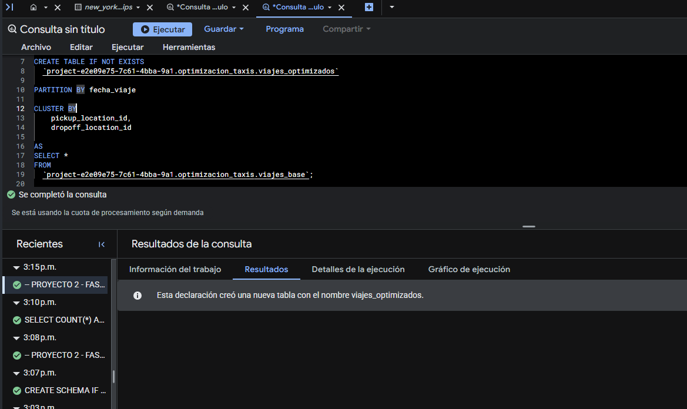

### 5.2. Primera validación — `9_validacion_tablas.sql`

El conteo contrastó **2,421,619 filas** en la tabla base frente a **0** en la tabla optimizada. Por tanto, todavía no era válido realizar pruebas comparativas.

**Script:** [`9_validacion_tablas.sql`](../ConsultasBigQuery/Optimizacion/9_validacion_tablas.sql)

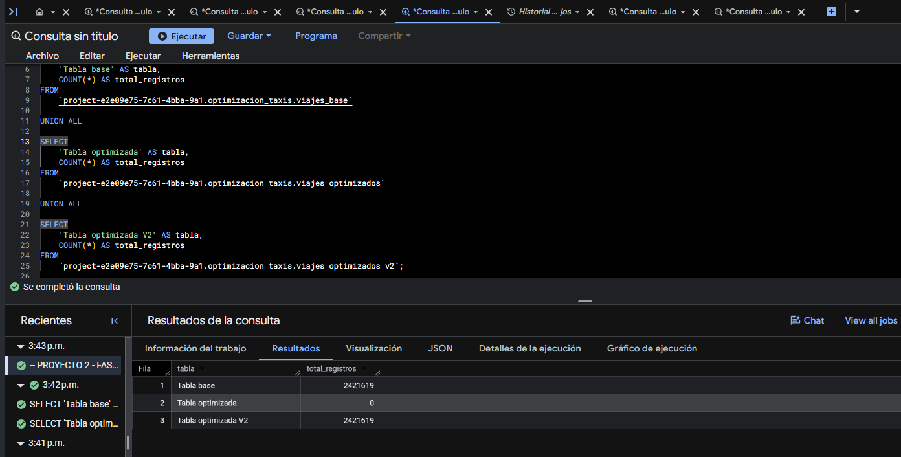

### 5.3. Intento de reconstrucción — `10_recreacion_tabla_optimizada.sql`

Se intentó reconstruir la tabla mediante `CREATE OR REPLACE TABLE ... AS SELECT`. El historial mostró una ejecución de aproximadamente **2.311 s** y **243.39 MB procesados**, pero la tabla volvió a quedar sin registros. También se probó `INSERT INTO`, que fue rechazado por Sandbox porque las operaciones DML requieren facturación habilitada. El intento de DML no corresponde a un script numerado en la carpeta actual, pero se conserva aquí como incidencia técnica.

**Script:** [`10_recreacion_tabla_optimizada.sql`](../ConsultasBigQuery/Optimizacion/10_recreacion_tabla_optimizada.sql)

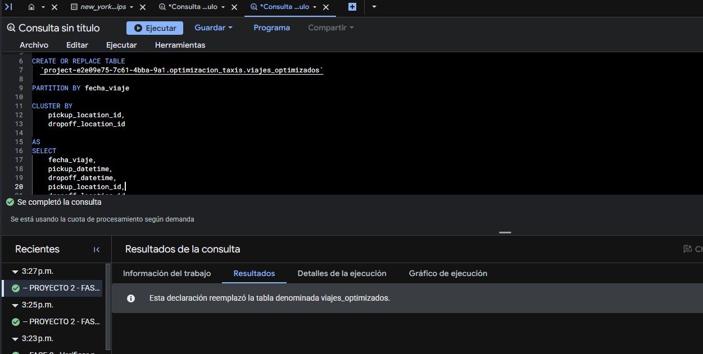

### 5.4. Diagnóstico de caducidad

Una consulta a `INFORMATION_SCHEMA.COLUMNS` confirmó que el esquema de `viajes_optimizados` era correcto: `fecha_viaje` era columna de partición; `pickup_location_id` y `dropoff_location_id` eran columnas de clustering en las posiciones 1 y 2. Luego, `INFORMATION_SCHEMA.TABLE_OPTIONS` mostró **`partition_expiration_days = 60.0`**.

Los datos originales son de enero de **2022** y el experimento se hizo en octubre de **2026**. Para las particiones diarias, el vencimiento se calcula respecto del límite temporal de la partición. Al cargar los datos históricos, las particiones de 2022 ya habían sobrepasado 60 días y sus registros expiraron. Esto explica por qué la definición sobrevivió, pero el conteo quedó en cero.

> **Nota metodológica:** se conservaron los scripts fallidos porque documentan una limitación técnica real del entorno de pruebas; sus errores no se presentan como resultados de optimización.

### 5.5. Solución con fecha auxiliar — `11_creacion_tabla_optimizada_corregida.sql`

Se creó una nueva tabla `viajes_optimizados_v2` con:

- `fecha_viaje`: fecha **original** de enero de 2022, preservada para el análisis.
- `fecha_particion`: fecha **auxiliar** reciente empleada exclusivamente para particionar.
- `PARTITION BY fecha_particion`.
- `CLUSTER BY pickup_location_id, dropoff_location_id`.

La fórmula utilizada en el momento de crear la tabla fue:

```sql
DATE_ADD(
  CURRENT_DATE(),
  INTERVAL EXTRACT(DAY FROM fecha_viaje) - 1 DAY
) AS fecha_particion
```

Con fecha de ejecución **21/10/2026**, produjo un rango auxiliar **21/10/2026–20/11/2026**, sin modificar las fechas reales del viaje. Su función es **demostrativa**, no un modelo de producción: `CURRENT_DATE()` depende del día de ejecución y los filtros auxiliares deben ajustarse si se reconstruye la tabla en otra fecha.

**Validación:** `viajes_base` y `viajes_optimizados_v2` contienen **2,421,619 registros** cada una, mientras la tabla histórica `viajes_optimizados` continúa vacía.

**Script:** [`11_creacion_tabla_optimizada_corregida.sql`](../ConsultasBigQuery/Optimizacion/11_creacion_tabla_optimizada_corregida.sql)

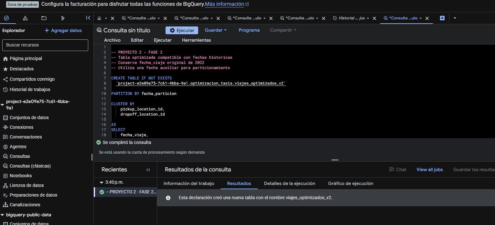

## 6. Comparación estándar vs. optimizada

**Pregunta evaluada:** para los viajes entre el **21 y el 25 de enero de 2022**, cuyo origen es la ubicación `132`, ¿cuántos viajes hay y cuáles son la distancia y el costo promedio?

### 6.1. Consulta de referencia — `12_comparacion_base.sql`

```sql
SELECT
  COUNT(*) AS total_viajes,
  ROUND(AVG(trip_distance), 2) AS distancia_promedio,
  ROUND(AVG(total_amount), 2) AS costo_promedio
FROM `project-e2e09e75-7c61-4bba-9a1.optimizacion_taxis.viajes_base`
WHERE fecha_viaje BETWEEN '2022-01-21' AND '2022-01-25'
  AND pickup_location_id = '132';
```

**Script:** [`12_comparacion_base.sql`](../ConsultasBigQuery/Optimizacion/12_comparacion_base.sql)

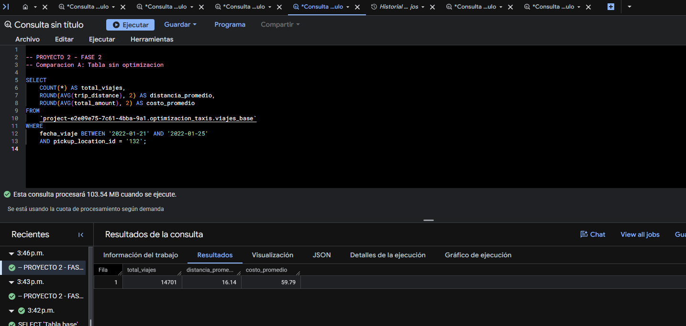

### 6.2. Consulta optimizada — `13_comparacion_optimizada.sql`

La comparación añade el filtro sobre la columna técnica de partición correspondiente a los mismos días originales. El resto de las condiciones y agregaciones son equivalentes:

```sql
SELECT
  COUNT(*) AS total_viajes,
  ROUND(AVG(trip_distance), 2) AS distancia_promedio,
  ROUND(AVG(total_amount), 2) AS costo_promedio
FROM `project-e2e09e75-7c61-4bba-9a1.optimizacion_taxis.viajes_optimizados_v2`
WHERE fecha_viaje BETWEEN '2022-01-21' AND '2022-01-25'
  AND fecha_particion BETWEEN '2026-11-10' AND '2026-11-14'
  AND pickup_location_id = '132';
```

**Script:** [`13_comparacion_optimizada.sql`](../ConsultasBigQuery/Optimizacion/13_comparacion_optimizada.sql)

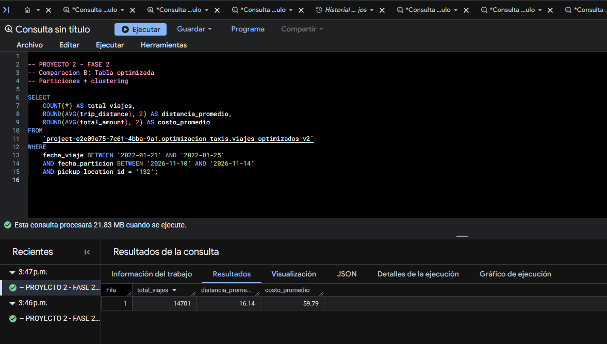

### 6.3. Resultados y reducción estimada

| Métrica                               |       Tabla base | Tabla optimizada V2 |
| ------------------------------------- | ---------------: | ------------------: |
| Viajes encontrados                    |       **14,701** |          **14,701** |
| Distancia promedio                    | **16.14 millas** |    **16.14 millas** |
| Costo promedio                        |    **USD 59.79** |       **USD 59.79** |
| Bytes **estimados antes de ejecutar** |    **103.54 MB** |        **21.83 MB** |

<!-- **Cálculo basado en las estimaciones mostradas en el editor:** -->

<!-- \[
\text{Reducción estimada} = \frac{103.54 - 21.83}{103.54} \times 100 \approx \mathbf{78.92\%}
\] -->

**Fórmula para calcular la reducción:**

$$
\text{Reducción (\%)} = \frac{B_{\text{base}} - B_{\text{optimizada}}}{B_{\text{base}}} \times 100
$$

**Cálculo basado en las estimaciones mostradas en el editor:**

$$
\text{Reducción estimada} = \frac{103.54 - 21.83}{103.54} \times 100 \approx \mathbf{78.92\%}
$$

Se estimó una disminución de **81.71 MB**, con los mismos resultados analíticos. Esto es una evidencia favorable de la combinación de particionamiento y clustering.

**Precaución:** los números de MB anteriores proceden de la **estimación previa a la ejecución**, no de capturas de los campos `Bytes procesados` y `Duración` en los detalles de cada trabajo. En tablas con clustering, los bytes reales pueden diferir de esa estimación. Por ello, el **78.92 % es una reducción estimada**, no un ahorro facturado ni una medición definitiva del tiempo. Para satisfacer plenamente la comparación de desempeño de la rúbrica, se recomienda adjuntar en una ampliación las métricas reales de ambos trabajos y registrar si se utilizó caché.

## 7. Resultados, limitaciones y conclusiones

1. Se realizaron consultas SQL avanzadas sobre el dataset de 2022, con análisis temporal, económico y geográfico.
2. La validación temporal mostró que diciembre tiene solo **57 registros** con `pickup_datetime` en 2022 en la tabla consultada; esta limitación debe advertirse al interpretar tendencias.
3. Se obtuvo un subconjunto **reproducible de 2,421,619 viajes válidos** para las pruebas de optimización.
4. La primera tabla particionada por las fechas originales quedó sin registros porque tenía vencimiento de **60 días** en particiones históricas.
5. El entorno Sandbox rechazó `INSERT INTO`, por lo que se documentó la limitación DML y se empleó una creación de tabla por consulta.
6. La variante `viajes_optimizados_v2` conservó las fechas originales y utilizó fechas auxiliares recientes para el particionamiento.
7. Las dos consultas de comparación entregaron resultados **idénticos**, con una **reducción estimada de bytes del 78.92 %** (103.54 MB frente a 21.83 MB).
8. La solución con fechas desplazadas se utilizó únicamente para la prueba técnica: no altera el análisis histórico, pero **no debe confundirse con un diseño recomendado de producción**.

## 8. Evidencias y scripts conservados

|  N.º | Script / actividad                                                                                                           | Evidencia                                                                       |
| ---: | ---------------------------------------------------------------------------------------------------------------------------- | ------------------------------------------------------------------------------- |
|    1 | [`1_analisis_temporal.sql`](../ConsultasBigQuery/Optimizacion/1_analisis_temporal.sql)                                       | [Captura 1](../images/Optimizacion/1_analisis_temporal.png)                     |
|    2 | [`2_validacion_cobertura_temporal.sql`](../ConsultasBigQuery/Optimizacion/2_validacion_cobertura_temporal.sql)               | [Captura 2](../images/Optimizacion/2_validacion_cobertura_temporal.png)         |
|    3 | [`3_analisis_economico.sql`](../ConsultasBigQuery/Optimizacion/3_analisis_economico.sql)                                     | [Captura 3](../images/Optimizacion/3_analisis_economico.png)                    |
|    4 | [`4_analisis_geografico.sql`](../ConsultasBigQuery/Optimizacion/4_analisis_geografico.sql)                                   | [Captura 4](../images/Optimizacion/4_analisis_geografico.png)                   |
|    5 | [`5_validacion_subconjunto.sql`](../ConsultasBigQuery/Optimizacion/5_validacion_subconjunto.sql)                             | [Captura 5](../images/Optimizacion/5_validacion_subconjunto.png)                |
|    6 | [`6_creacion_dataset.sql`](../ConsultasBigQuery/Optimizacion/6_creacion_dataset.sql)                                         | [Captura 6](../images/Optimizacion/6_creacion_dataset.png)                      |
|    7 | [`7_creacion_tabla_base.sql`](../ConsultasBigQuery/Optimizacion/7_creacion_tabla_base.sql)                                   | [Captura 7](../images/Optimizacion/7_creacion_tabla_base.png)                   |
|    8 | [`8_creacion_tabla_optimizada.sql`](../ConsultasBigQuery/Optimizacion/8_creacion_tabla_optimizada.sql)                       | [Captura 8](../images/Optimizacion/8_creacion_tabla_optimizada.png)             |
|    9 | [`9_validacion_tablas.sql`](../ConsultasBigQuery/Optimizacion/9_validacion_tablas.sql)                                       | [Captura 9](../images/Optimizacion/9_validacion_tablas.png)                     |
|   10 | [`10_recreacion_tabla_optimizada.sql`](../ConsultasBigQuery/Optimizacion/10_recreacion_tabla_optimizada.sql)                 | [Captura 10](../images/Optimizacion/10_recreacion_tabla_optimizada.sql.png)     |
|   11 | [`11_creacion_tabla_optimizada_corregida.sql`](../ConsultasBigQuery/Optimizacion/11_creacion_tabla_optimizada_corregida.sql) | [Captura 11](../images/Optimizacion/11_creacion_tabla_optimizada_corregida.png) |
|   12 | [`12_comparacion_base.sql`](../ConsultasBigQuery/Optimizacion/12_comparacion_base.sql)                                       | [Captura 12](../images/Optimizacion/12_comparacion_base.png)                    |
|   13 | [`13_comparacion_optimizada.sql`](../ConsultasBigQuery/Optimizacion/13_comparacion_optimizada.sql)                           | [Captura 13](../images/Optimizacion/13_comparacion_optimizada.png)              |

## 9. Siguiente fase

**Fase 3 — BigQuery ML:** preparar un conjunto de entrenamiento limpio, justificar variables predictoras y variable objetivo, evitar fuga de información, implementar al menos dos modelos, evaluar sus métricas y generar predicciones. Antes de iniciar el entrenamiento, comprobar que los modelos y operaciones necesarios estén disponibles en la modalidad Sandbox sin activar facturación.
