# Fase 3 — Modelos predictivos con BigQuery ML


Entrenamiento, validación interna, evaluación independiente con TEST y predicciones de los dos modelos.

## 1. Objetivo

Entrenar y comparar dos modelos de regresión para estimar el importe de la tarifa de un viaje de taxi (`fare_amount`) a partir de características del recorrido, documentando preparación de datos, división temporal, hiperparámetros, métricas y medidas para evitar *data leakage*. Los dos modelos se entrenaron en **BigQuery ML**, sobre el proyecto `project-e2e09e75-7c61-4bba-9a1`, dataset `optimizacion_taxis`.

> **Alcance de la predicción:** se conoce la distancia realmente recorrida (`trip_distance`). Por ello se trata de una estimación con información del trayecto, **no** de una cotización previa al viaje basada exclusivamente en información disponible antes de iniciarlo.

## 2. Datos y preparación

Se utilizó `optimizacion_taxis.viajes_base`, creada en la Fase 2, con **2,421,619 viajes** de enero de 2022. No se requirió crear una nueva tabla física para la preparación: se usaron consultas SQL y expresiones temporales.

### 2.1. Variable objetivo y características

| Papel | Campo de origen | Columna del modelo | Tipo y tratamiento |
|---|---|---|---|
| Objetivo | `fare_amount` | `tarifa_objetivo` | `FLOAT64`, tarifa del viaje en USD |
| Entrada | `trip_distance` | `distancia` | `FLOAT64`, distancia recorrida |
| Entrada | `passenger_count` | `pasajeros` | `STRING`, `COALESCE(passenger_count, -1)` para representar «desconocido» como categoría |
| Entrada | `pickup_location_id` | `origen` | `STRING`, ubicación de inicio |
| Entrada | `dropoff_location_id` | `destino` | `STRING`, ubicación de fin |
| Entrada derivada | `pickup_datetime` | `hora_inicio` | `INT64`, `EXTRACT(HOUR ...)` |
| Entrada derivada | `pickup_datetime` | `dia_semana` | `INT64`, `EXTRACT(DAYOFWEEK ...)` |

**Ingeniería de características:** transformación de pasajeros nulos a una categoría identificable; extracción de hora y día de la semana; conservación de ubicaciones como categorías. En el entrenamiento se filtraron tarifas entre **USD 0 y 300** y ubicaciones no nulas. Este umbral es una decisión de preparación del ejercicio, no una regla universal sobre tarifas válidas.

### 2.2. Prevención de *data leakage*

- **No se utilizaron `total_amount`, `tip_amount` ni otros componentes posteriores al viaje como entradas**: `total_amount` contiene información relacionada directamente con la tarifa a predecir, y las propinas tampoco son conocidas en el momento de la estimación planteada. Usarlas podría producir fuga de información (*data leakage*) y métricas artificialmente favorables.
- No se incluyó `fare_amount` entre las entradas; se utilizó **solo como etiqueta** (`tarifa_objetivo`).
- Se preservó un **corte cronológico**: entrenamiento con fechas anteriores a validación y prueba. El conjunto TEST no participó en el entrenamiento ni en la elección inicial de modelos.
- No se aplicaron transformaciones estimadas con el conjunto TEST. La categoría fija `-1` para pasajeros desconocidos no requiere estimar estadísticas de validación/prueba.

### 2.3. División temporal

| Conjunto | Fechas | Registros aptos registrados | Propósito |
|---|---|---:|---|
| TRAIN | 1–20 de enero de 2022 | 1,512,759 | Ajustar parámetros del modelo |
| EVAL | 21–25 de enero de 2022 | 433,210 | Evaluación interna y comparación inicial |
| TEST | 26–31 de enero de 2022 | 475,610 | Evaluación final independiente, **completada** |

En el SQL de entrenamiento se usaron `DATA_SPLIT_METHOD = 'CUSTOM'` y `DATA_SPLIT_COL = 'es_validacion'`, con `es_validacion = (fecha_viaje >= DATE '2022-01-21')` y filtro `fecha_viaje < DATE '2022-01-26'`. Así TRAIN y EVAL quedan incluidos en el entrenamiento/configuración del modelo y TEST queda excluido. **No confundir la evaluación interna de `ML.EVALUATE` sin datos de entrada con la evaluación final sobre TEST**.

**Validación inicial (consulta 1):** se hallaron 27, 6 y 7 tarifas fuera del rango establecido para TRAIN, EVAL y TEST, respectivamente; pasajeros nulos: 36,073, 12,203 y 20,229; sin tarifas ni ubicaciones nulas en los tres grupos. La preparación (consulta 2) produjo las cantidades aptas de la tabla anterior y 36,071 / 12,203 / 20,228 pasajeros categorizados como desconocidos.

#### Evidencias de preparación

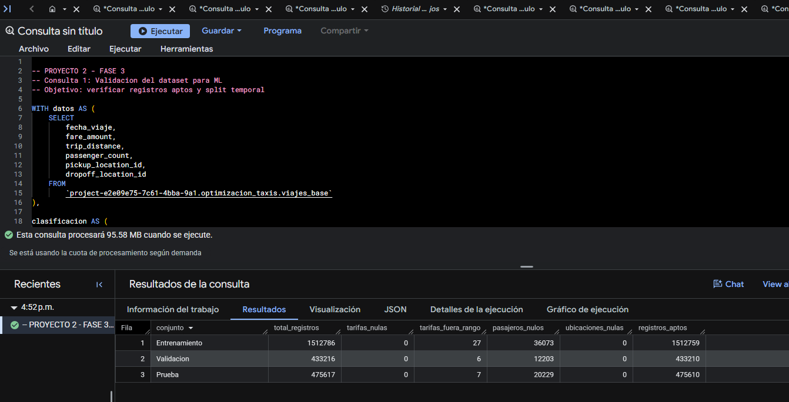

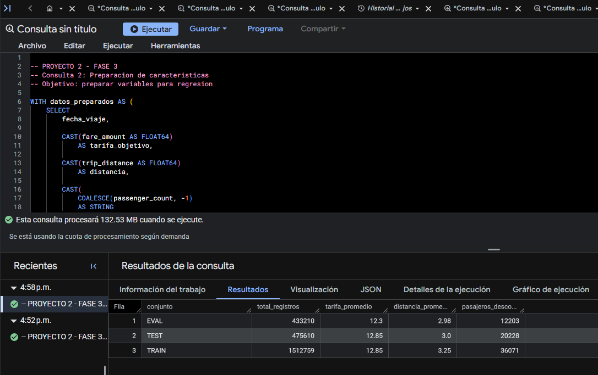

**SQL:** [`1_validacion_datos_ml.sql`](../ConsultasBigQuery/MachineLearning/1_validacion_datos_ml.sql) · [`2_preparacion_caracteristicas.sql`](../ConsultasBigQuery/MachineLearning/2_preparacion_caracteristicas.sql)

## 3. Modelo 1: regresión lineal

**Modelo:** `optimizacion_taxis.modelo_regresion_lineal`  
**Tipo:** `LINEAR_REG`  
**Objetivo:** predecir `tarifa_objetivo` con una combinación lineal de las características, con tratamiento de variables categóricas por BigQuery ML.

| Opción | Valor |
|---|---|
| `input_label_cols` | `['tarifa_objetivo']` |
| `data_split_method` | `CUSTOM` |
| `data_split_col` | `es_validacion` |
| `l2_reg` | `0.1` |
| `max_iterations` | `20` |

**Regularización L2:** penaliza coeficientes grandes y busca limitar la complejidad del ajuste. **Iteraciones máximas:** límite de pasos del optimizador; no implica que necesariamente se ejecutaran 20 iteraciones, salvo confirmación específica en las métricas de entrenamiento.

**Resultado:** BigQuery confirmó la creación del modelo. Sus columnas de entrada son distancia, pasajeros, origen, destino, hora y día de la semana.

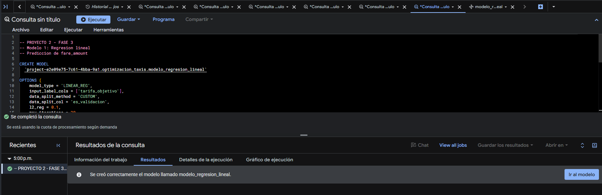

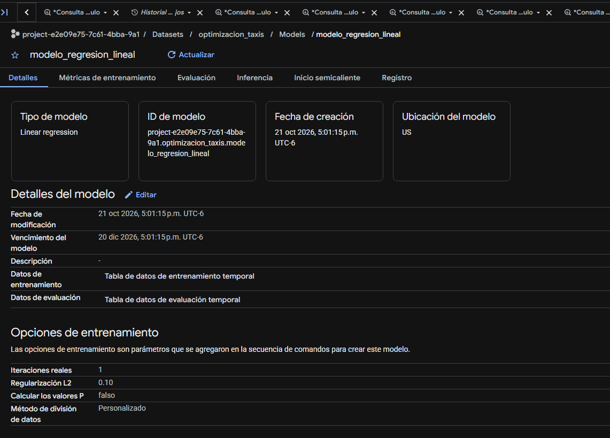

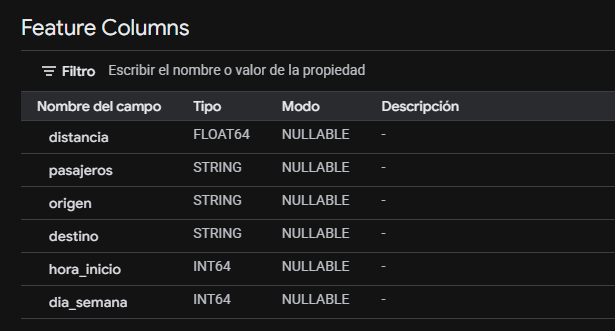

**SQL:** [`3_modelo_regresion_lineal.sql`](../ConsultasBigQuery/MachineLearning/3_modelo_regresion_lineal.sql)

### 3.1. Evaluación interna del modelo 1

Se ejecutó `ML.EVALUATE(MODEL ...)` **sin proporcionar un nuevo conjunto de entrada**; recupera las métricas de evaluación interna asociadas al modelo.

| Métrica | Resultado aproximado |
|---|---:|
| MAE | 1.4938 USD |
| MSE | 9.6991 USD² |
| RMSE (`SQRT(MSE)`) | 3.1143 USD |
| MSLE | 0.03118 |
| Mediana del error absoluto | 1.0418 USD |
| R² | 0.9161 |
| Varianza explicada | 0.9163 |

**Interpretación:** el MAE es el error absoluto medio en unidades monetarias; RMSE penaliza más los errores grandes; R² indica la fracción de variabilidad de la tarifa explicada dentro del conjunto evaluado, **no** el porcentaje de viajes acertados.

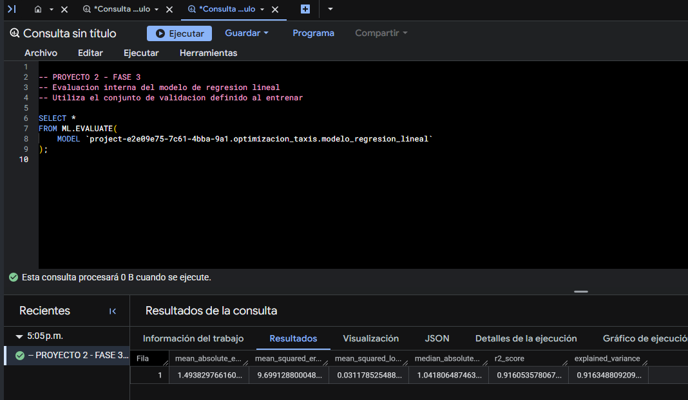

**SQL:** [`4_evaluacion_regresion_lineal.sql`](../ConsultasBigQuery/MachineLearning/4_evaluacion_regresion_lineal.sql)

## 4. Modelo 2: árboles potenciados (XGBoost)

**Modelo:** `optimizacion_taxis.modelo_arboles_potenciados`  
**Tipo:** `BOOSTED_TREE_REGRESSOR`  
**Objetivo y entradas:** exactamente los mismos campos que la regresión lineal.

| Hiperparámetro | Valor confirmado |
|---|---:|
| Iteraciones máximas configuradas | 20 |
| **Iteraciones reales** | **20** |
| Profundidad máxima del árbol | 4 |
| Tasa de aprendizaje (`learn_rate`) | 0.10 |
| Submuestreo (`subsample`) | 0.80 |
| Regularización L1 | 0.00 |
| Regularización L2 | 1.00 |
| División de datos | `CUSTOM` |

### 4.1. ¿Qué significan las 20 iteraciones?

XGBoost es un método de *boosting*: construye **sucesivamente** árboles de decisión, y cada nuevo árbol busca mejorar las predicciones del conjunto anterior corrigiendo errores residuales. En esta configuración, `max_iterations = 20` establece el número máximo de rondas; el panel de BigQuery confirma **20 iteraciones reales**, por lo que se ejecutaron las 20. Esto **no significa que se haya alcanzado el mejor modelo posible**: para evaluarlo se necesitan métricas y, si se desea, experimentar con hiperparámetros bajo un protocolo consistente.

- **Profundidad máxima 4:** limita la complejidad de cada árbol.
- **Tasa 0.10:** reduce la contribución de cada ronda, buscando un aprendizaje gradual.
- **Submuestreo 0.80:** usa una parte de las filas en las rondas de entrenamiento para favorecer generalización.
- **Regularización:** introduce penalizaciones que controlan la complejidad del modelo.

### 4.2. ¿Por qué tardó más que la regresión lineal?

El entrenamiento de XGBoost requirió bastante más tiempo porque procesa repetidamente un volumen elevado de datos (más de 1.5 millones de viajes de TRAIN), evalúa divisiones de características para construir árboles, incorpora variables categóricas de origen y destino y repite el procedimiento durante 20 rondas. La regresión lineal tiene una forma funcional más sencilla y normalmente exige menos trabajo de entrenamiento.

Durante la ejecución se observó una duración transcurrida de **16 min 48 s** y **5 h 4 min de tiempo de ranura acumulado**. Son medidas distintas: el tiempo de ranura suma recursos de procesamiento paralelo y **no equivale** a cinco horas de espera ni demuestra por sí mismo un cobro. El entrenamiento posteriormente finalizó exitosamente; la duración total final no fue registrada en las evidencias suministradas.

**Resultado:** BigQuery confirmó la creación del modelo con 20 iteraciones ejecutadas, sin que se habilitara facturación durante este flujo. Esto no constituye garantía general de gratuidad para cualquier modelo o proyecto.

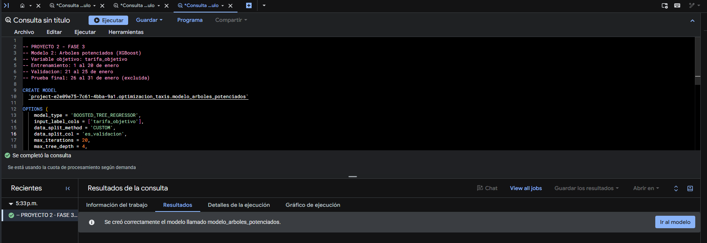

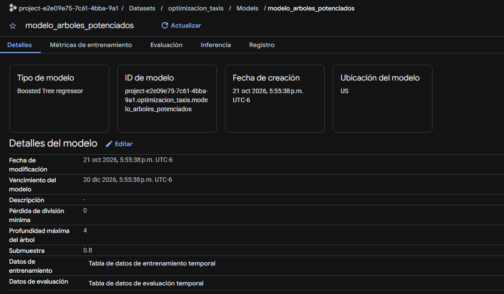

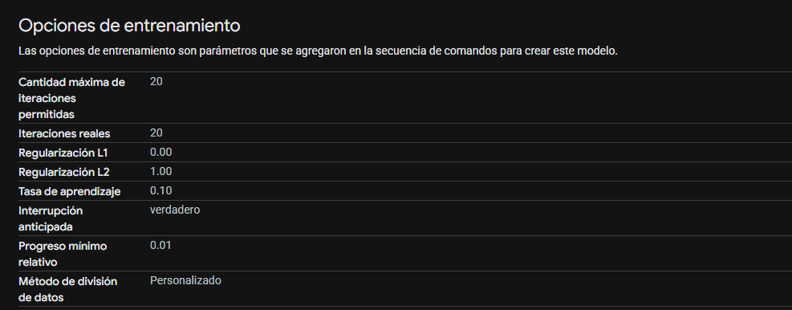

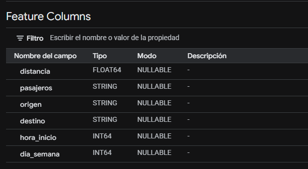

**SQL:** [`5_modelo_arboles_potenciados.sql`](../ConsultasBigQuery/MachineLearning/5_modelo_arboles_potenciados.sql)

### 4.3. Evaluación interna del modelo 2

| Métrica | Resultado |
|---|---:|
| MAE | 1.8549 USD |
| MSE | 16.6887 USD² |
| RMSE | 4.0852 USD |
| MSLE | 0.0381 |
| Mediana del error absoluto | 1.0941 USD |
| R² | 0.8556 |
| Varianza explicada | 0.8773 |

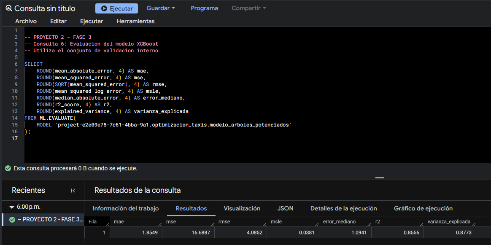

**SQL:** [`6_evaluacion_arboles_potenciados.sql`](../ConsultasBigQuery/MachineLearning/6_evaluacion_arboles_potenciados.sql)

## 5. Comparación de modelos (evaluación interna)

| Métrica | Regresión lineal | XGBoost | Dirección favorable |
|---|---:|---:|---|
| MAE (USD) | ≈ 1.4938 | 1.8549 | Menor |
| MSE (USD²) | ≈ 9.6991 | 16.6887 | Menor |
| RMSE (USD) | ≈ 3.1143 | 4.0852 | Menor |
| MSLE | ≈ 0.03118 | 0.0381 | Menor |
| Error absoluto mediano (USD) | ≈ 1.0418 | 1.0941 | Menor |
| R² | ≈ 0.9161 | 0.8556 | Mayor |
| Varianza explicada | ≈ 0.9163 | 0.8773 | Mayor |

**Hallazgo:** bajo las configuraciones y validación interna utilizadas, **la regresión lineal obtuvo mejores métricas que XGBoost**. No debe asumirse que los árboles potenciados siempre superarán a un modelo lineal; las prestaciones dependen de las características del problema y de sus hiperparámetros. Aquí los valores de la regresión lineal provienen de la captura con decimales truncados en pantalla, por lo que se reportan de forma aproximada.

La comparación interna **no sustituye la evaluación final** de ambos modelos con los mismos registros del conjunto TEST (26–31 de enero), que quedó reservado sin uso para entrenar. Tampoco se ha realizado una búsqueda sistemática de hiperparámetros: se reportan las configuraciones concretas que se ejecutaron.

## 6. Evaluación final independiente sobre TEST

Para verificar la generalización se evaluaron ambos modelos, **sin volver a entrenarlos**, sobre el conjunto TEST del **26 al 31 de enero de 2022**, formado por **475,610 registros aptos** según los filtros aplicados. Se empleó `ML.EVALUATE` con una consulta de entrada explícita, a diferencia de las evaluaciones internas que recuperaban métricas guardadas del entrenamiento. Ambos scripts utilizaron los mismos filtros y las mismas seis características, de modo que la comparación se realiza sobre la misma población.

| Métrica TEST | Regresión lineal | XGBoost | Mejor |
|---|---:|---:|---|
| MAE (USD) | **1.8179** | 2.2985 | Regresión lineal |
| MSE (USD²) | **14.2869** | 22.2631 | Regresión lineal |
| RMSE (USD) | **3.7798** | 4.7184 | Regresión lineal |
| Mediana de error absoluto (USD) | **1.1176** | 1.3085 | Regresión lineal |
| R² | **0.8839** | 0.8190 | Regresión lineal |
| Varianza explicada | **0.8869** | 0.8532 | Regresión lineal |

**Interpretación:** el modelo lineal presenta un error absoluto promedio de aproximadamente USD 1.82 por viaje, frente a USD 2.30 para XGBoost. El R² de 0.8839 indica que explica aproximadamente el 88.39 % de la variabilidad en las tarifas de TEST; no representa una tasa de aciertos. Ambos modelos empeoraron respecto de su validación interna, lo cual refuerza la necesidad de reservar datos temporalmente posteriores.

**Comparación de generalización:** en regresión lineal el MAE pasó de aproximadamente 1.4938 (EVAL) a 1.8179 (TEST); en XGBoost, de 1.8549 a 2.2985. La menor complejidad del primer modelo no impidió que generalizara mejor con esta configuración. No se reajustaron parámetros a partir de TEST, para evitar contaminación de la evaluación final.

**Consultas ejecutadas:** [`7_test_regresion_lineal.sql`](../ConsultasBigQuery/MachineLearning/7_test_regresion_lineal.sql) y [`8_test_arboles_potenciados.sql`](../ConsultasBigQuery/MachineLearning/8_test_arboles_potenciados.sql).

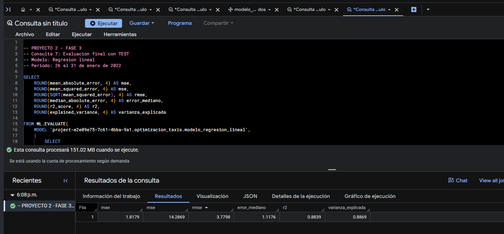

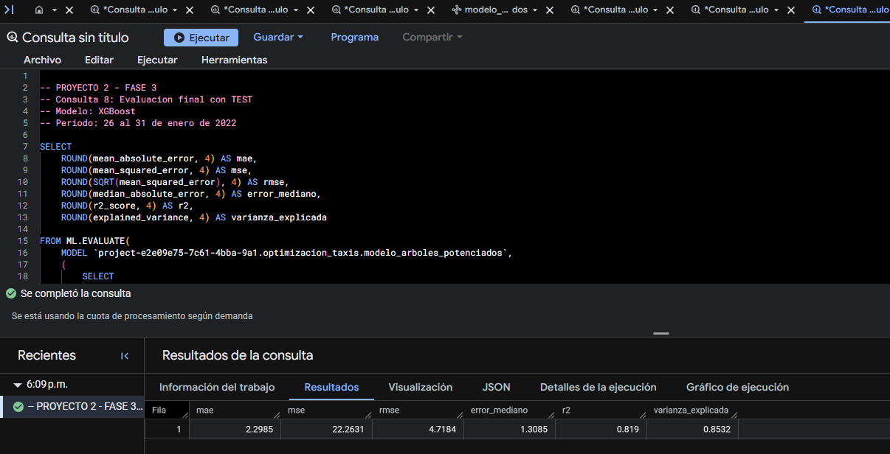

## 7. Predicciones con registros no vistos

Se ejecutó `ML.PREDICT` para cada modelo sobre una **muestra determinista** extraída de TEST mediante `FARM_FINGERPRINT`. Los ejemplos presentados corresponden a los últimos días de enero, que se reservaron completamente durante el entrenamiento. Los scripts muestran hasta 20 filas y calculan `error_absoluto = ABS(tarifa_real - tarifa_predicha)`.

### 7.1. Regresión lineal

El script [`9_predicciones_regresion_lineal.sql`](../ConsultasBigQuery/MachineLearning/9_predicciones_regresion_lineal.sql) produjo tarifas reales, estimadas, errores individuales y distancias. Se observó, por ejemplo, una tarifa real de **USD 65.00** para 0.01 millas frente a una predicción de **USD 4.51**, con error absoluto **USD 60.49**. También se observaron viajes ordinarios con errores mucho menores. Es una evidencia de que buenas métricas promedio pueden coexistir con errores importantes en casos atípicos.

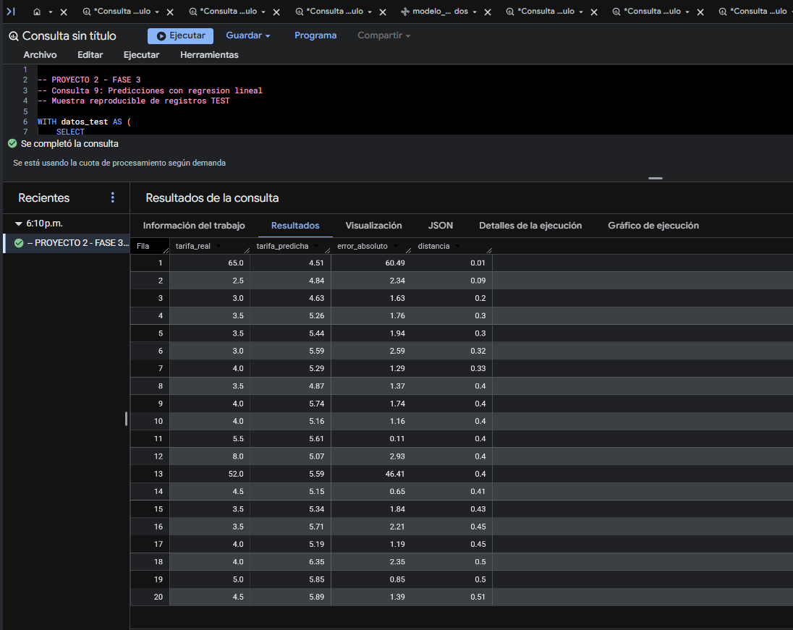

### 7.2. Árboles potenciados

El script [`10_predicciones_arboles_potenciados.sql`](../ConsultasBigQuery/MachineLearning/10_predicciones_arboles_potenciados.sql) ejecutó `ML.PREDICT` sobre la **misma regla de muestreo**. En los ejemplos observados, la tarifa de USD 65.00 se predijo como **USD 5.50** (error USD 59.50) y una tarifa de USD 52.00 se predijo como **USD 4.70** (error USD 47.30). Esto evidencia que el modelo también puede fallar mucho en viajes extremos o atípicos, aunque responda razonablemente en numerosos viajes habituales.

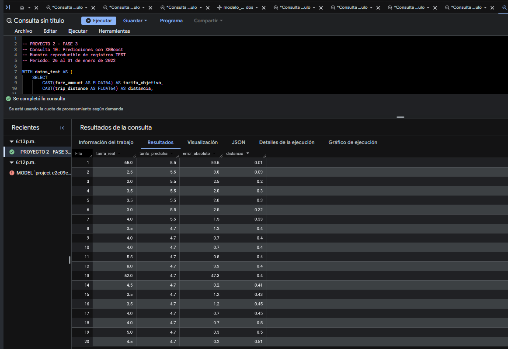


> **Limitación de esta muestra:** los 20 ejemplos se ordenaron por `distancia`, por lo que son ilustrativos y no una muestra representativa del error general. Para comparar desempeño global deben utilizarse las métricas calculadas sobre los 475,610 registros TEST, no el promedio de esas 20 filas.

## 8. Hiperparámetros, resultados y selección final

| Elemento | Regresión lineal | Árboles potenciados |
|---|---|---|
| Algoritmo | `LINEAR_REG` | `BOOSTED_TREE_REGRESSOR` |
| Función objetivo | `fare_amount` como `tarifa_objetivo` | Igual |
| Características | Distancia, pasajeros, origen, destino, hora, día de semana | Idénticas |
| Separación temporal | TRAIN / EVAL / TEST | TRAIN / EVAL / TEST |
| Parámetros clave | `l2_reg=0.1`, `max_iterations=20` | `max_iterations=20`, `max_tree_depth=4`, `learn_rate=0.1`, `subsample=0.8` |
| Iteraciones completadas | No verificadas en evidencia | **20 confirmadas** |
| MAE TEST | **1.8179** | 2.2985 |
| RMSE TEST | **3.7798** | 4.7184 |
| R² TEST | **0.8839** | 0.8190 |

**Decisión técnica:** con estas configuraciones, se selecciona **regresión lineal** como el modelo con mejor desempeño final. Los árboles potenciados pueden modelar relaciones no lineales, pero su mayor complejidad y 20 iteraciones no se tradujeron en mejores métricas en este ejercicio. La decisión aplica a este subconjunto y a los hiperparámetros ensayados; no prueba que la regresión lineal sea superior en todos los escenarios.

**Por qué XGBoost tardó más:** cada ronda entrena nuevos árboles para corregir errores de rondas anteriores. Con más de 1.5 millones de registros, ubicaciones categóricas y hasta cuatro niveles por árbol, se necesita trabajo repetido. Las **20 iteraciones** son 20 rondas efectivamente completadas (confirmadas en BigQuery), no 20 conjuntos de datos distintos ni 20 modelos independientes. La captura durante la ejecución registró 16 min 48 s transcurridos y 5 h 4 min de ranura acumulada; el tiempo de ranura contabiliza cómputo paralelo y no debe interpretarse como duración de pared ni como un cargo monetario.

## 9. Scripts y evidencias de la Fase 3

Todos los scripts SQL se guardaron en `P2/ConsultasBigQuery/MachineLearning/`:

```text
1_validacion_datos_ml.sql
2_preparacion_caracteristicas.sql
3_modelo_regresion_lineal.sql
4_evaluacion_regresion_lineal.sql
5_modelo_arboles_potenciados.sql
6_evaluacion_arboles_potenciados.sql
7_test_regresion_lineal.sql
8_test_arboles_potenciados.sql
9_predicciones_regresion_lineal.sql
10_predicciones_arboles_potenciados.sql
```

Las imágenes están en `P2/images/MachineLearning/`:

```text
1_validacion_datos_ml.png
2_preparacion_caracteristicas.png
3_modelo_regresion_lineal.png
3.1_detalles_modelo_regresion_lineal.png
3.2_columnas_modelo_regresion_lineal.png
4_evaluacion_regresion_lineal.png
5_modelo_arboles_potenciados.png
5.1_detalles_modelo_arboles_potenciados.png
5.2_detalles_modelo_arboles_potenciados.png
5.3_columnas_modelo_arboles_potenciados.png
6_evaluacion_arboles_potenciados.png
7_test_regresion_lineal.png
8_test_arboles_potenciados.png
9_predicciones_regresion_lineal.png
10_predicciones_arboles_potenciados.png
```

Las quince evidencias se muestran en sus apartados respectivos mediante rutas relativas que parten de `P2/docs/`. Los enlaces a los SQL permiten abrir el procedimiento técnico completo. Para visualizar las capturas en VS Code, abrir la vista previa Markdown (`Ctrl + Shift + V`).

## 10. Limitaciones y conclusión

- El análisis cubre viajes válidos de enero de 2022 con restricciones de calidad y tarifa entre 0 y 300 USD; no se garantiza generalización a otros meses o ciudades.
- Se utiliza la distancia real del recorrido, por lo que el objetivo es estimar la tarifa con datos del trayecto, **no** ofrecer necesariamente una cotización antes de iniciarlo.
- Para evitar *data leakage*, se excluyeron `total_amount` y propinas; TEST estuvo separado cronológicamente y no se utilizó para reentrenamiento.
- La categoría `-1` identifica pasajeros desconocidos sin suponer un número real; un tratamiento más avanzado requeriría experimentos adicionales solo con TRAIN/EVAL.
- La comparación comprende **dos configuraciones específicas** de modelos; no se realizó una búsqueda exhaustiva de hiperparámetros. Para futuros ajustes deberá mantenerse TEST intacto y emplearse un nuevo conjunto final si TEST se utiliza iterativamente para decisiones.
- BigQuery Sandbox permitió ejecutar el entrenamiento y evaluación registrados en este proyecto sin habilitar facturación, pero sus cuotas, caducidad y restricciones siguen aplicando.

**Conclusión final:** se completó la preparación, entrenamiento, evaluación interna, **evaluación independiente TEST** y generación de predicciones de dos modelos BigQuery ML. **La regresión lineal fue la mejor opción en este experimento**: MAE TEST 1.8179 USD, RMSE TEST 3.7798 USD y R² 0.8839, mejores que los de XGBoost con los hiperparámetros ensayados. Las métricas, los ejemplos de errores extremos, los scripts y las evidencias respaldan una comparación reproducible, trazable y coherente con los criterios de la rúbrica. 

## 11. Siguiente fase

**Fase 4 — Dashboard:** Los resultados quedan listos para incorporar sus visualizaciones al tablero de la Fase 4.

