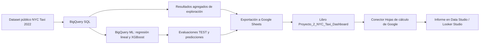

# Proyecto 2 — Fase 4: Dashboard de análisis y Machine Learning

**Dataset:** NYC Yellow Taxi Trips 2022  
**Herramientas:** Google BigQuery, BigQuery ML, Google Sheets y Google Data Studio (denominación mostrada por la interfaz utilizada; también conocido como Looker Studio).  
**Informe:** [Proyecto 2 — NYC Taxi: Análisis y Machine Learning](https://datastudio.google.com/reporting/a35f0e0b-044f-4a87-9f8d-4cb9a5f1a2a4)  
**Estado:** Dashboard de cuatro páginas y siete gráficos completado.

> **Alcance:** El análisis exploratorio usa los resultados agregados consultados para el dataset de 2022. El entrenamiento, evaluación y predicción de los modelos se limitó a enero de 2022. No se implementó un *rolling forecast* temporal; la visualización de predicciones corresponde a tarifas de viajes individuales.

## 1. Objetivo

Construir un dashboard que comunique los principales hallazgos exploratorios del dataset NYC Yellow Taxi Trips 2022 y los resultados de la comparación de dos modelos de regresión entrenados en BigQuery ML: regresión lineal y árboles potenciados (XGBoost). El informe permite observar volumen temporal de viajes, costos por distancia, zonas de origen, métricas de precisión y ejemplos de predicción.

## 2. Arquitectura y flujo de datos

### 2.1 BigQuery: generación de resultados

Se reutilizaron consultas SQL de la Fase 2 (`1_analisis_temporal.sql`, `3_analisis_economico.sql`, `4_analisis_geografico.sql`) para obtener tablas resumidas. Para Machine Learning se reutilizaron los resultados de las consultas de la Fase 3, en particular `7_test_regresion_lineal.sql`, `8_test_arboles_potenciados.sql`, `9_predicciones_regresion_lineal.sql` y `10_predicciones_arboles_potenciados.sql`.

Se trabajó con resultados **agregados o muestras pequeñas**, sin trasladar los 36,256,539 registros del dataset original al dashboard.

### 2.2 Exportación: BigQuery → Google Sheets

En BigQuery, después de ejecutar cada consulta, se eligió **Guardar los resultados → Hojas de cálculo de Google**. BigQuery generó archivos temporales de resultados en Drive (`results-...`). Los encabezados y valores se copiaron a un libro de trabajo centralizado llamado `Proyecto_2_NYC_Taxi_Dashboard`.

Las cinco pestañas de ese libro quedaron organizadas así:

| Hoja | Estructura principal | Propósito |
|---|---|---|
| `Viajes_Mensuales` | `mes`, `total_viajes`, `distancia_promedio`, `costo_promedio`, `duracion_promedio_minutos` | Evolución mensual del volumen de viajes |
| `Analisis_Economico` | `rango_distancia`, `total_viajes`, `distancia_promedio`, `tarifa_promedio`, `propina_promedio`, `costo_total_promedio` | Comparar el costo promedio por intervalo de millas |
| `Analisis_Geografico` | `ubicacion_origen`, `total_viajes`, y métricas agregadas | Identificar las zonas de origen más frecuentes |
| `Metricas_Modelos` | `modelo`, `mae`, `mse`, `rmse`, `error_mediano`, `r2`, `varianza_explicada` | Comparar modelos sobre TEST |
| `Predicciones` | `tarifa_real`, `prediccion_lineal`, `prediccion_xgboost`, `distancia`, `error_lineal`, `error_xgboost`, `id_viaje` | Mostrar 20 ejemplos de tarifas predichas y sus errores |

**Control de tipos de datos:** se corrigieron campos importados como texto o fecha debido a la interpretación de decimales, manteniendo `modelo` y `rango_distancia` como texto y las métricas como números decimales. Se verificaron los valores originales de BigQuery antes de conectarlos al informe. En `Predicciones` se añadió `id_viaje` (1–20) como identificador visual de la muestra.

> **Nota de correspondencia:** los 20 registros de ejemplo se combinaron a partir de dos salidas SQL ordenadas de la misma manera y transcritas para visualización. No se dispone de una clave única del viaje en esas salidas para acreditar de forma inequívoca el emparejamiento fila a fila. Por ello, los gráficos de predicción individual tienen carácter **ilustrativo**; las métricas de evaluación formales proceden de `ML.EVALUATE` sobre TEST.

### 2.3 Conexión: Google Sheets → Data Studio

Se creó un informe nuevo en la interfaz de **Data Studio**. Se seleccionó el conector **Hojas de cálculo de Google**, el libro `Proyecto_2_NYC_Taxi_Dashboard` y cada pestaña como **fuente independiente**; se mantuvo la primera fila como encabezados.

Se configuraron las dimensiones y las métricas en los gráficos, se corrigieron tipos de dato y se evitaron las agregaciones de *recuento distinto* (`CTD`) donde debían mostrarse importes numéricos. Cuando fue apropiado se usó `SUM`: con una sola fila por rango o por modelo coincide con el promedio o valor previamente calculado en BigQuery. Se deshabilitó **«Agrupar el resto como Otros»** cuando impedía mostrar todos los meses o categorías.

El dashboard consulta las hojas de Google Sheets, **no ejecuta directamente nuevas consultas de BigQuery al visualizarse**. Esta decisión limita la necesidad de volver a habilitar la facturación de Google Cloud; no implica que cualquier operación ajena al dashboard esté necesariamente exenta de costo.

## 3. Páginas del dashboard y evidencias

### Página 1 — Análisis temporal y económico

#### 3.1 Cantidad de viajes mensuales — NYC Taxi 2022

**Tipo:** columnas verticales. **Fuente:** `Viajes_Mensuales`. **Dimensión:** `mes`. **Métrica:** `total_viajes`. Se muestran individualmente los doce meses en orden cronológico.

**Interpretación:** marzo y octubre presentan los mayores volúmenes mensuales del conjunto consultado (aproximadamente 3.57 y 3.59 millones de viajes, respectivamente). Enero registra cerca de 2.42 millones. Diciembre muestra únicamente **57 registros** en la tabla pública utilizada: una anomalía de cobertura que impide interpretar ese valor como el tráfico total real de diciembre de 2022. Debe indicarse explícitamente esta limitación al presentar el dashboard.

#### 3.2 Costo promedio por distancia recorrida

**Tipo:** columnas verticales. **Fuente:** `Analisis_Economico`. **Dimensión:** `rango_distancia`. **Métrica:** `costo_total_promedio`.

| Distancia | Costo total promedio (USD) |
|---|---:|
| 0–2 millas | 12.91 |
| 2–5 millas | 20.25 |
| 5–10 millas | 34.64 |
| 10–20 millas | 61.61 |
| Más de 20 millas | 84.23 |

**Interpretación:** el costo total promedio aumenta conforme crece la distancia recorrida. Estos son promedios descriptivos por grupo, no tarifas predichas por los modelos ML ni una relación causal demostrada.

### Página 2 — Análisis geográfico

#### 3.3 Top 10 ubicaciones de origen — NYC Taxi 2022

**Tipo:** barras horizontales. **Fuente:** `Analisis_Geografico`. **Dimensión:** `ubicacion_origen`. **Métrica:** `total_viajes`. Se muestran diez categorías, sin agrupación en «Otros».

**Interpretación:** las ubicaciones `132` y `237` concentran aproximadamente **1.68 millones de viajes** cada una; les siguen `236` y `161`. Los códigos representan identificadores de zona y no equivalen por sí mismos a nombres de barrios; se requeriría una tabla de correspondencia de zonas para mostrar nombres geográficos descriptivos.

### Página 3 — Evaluación de modelos predictivos

**Alcance de ML:** los modelos de regresión lineal y árboles potenciados (XGBoost) utilizaron datos de enero de 2022. El entrenamiento correspondió al 1–20 de enero, la validación al 21–25 y TEST al 26–31 de enero. Se preservó la separación temporal y se evitaron predictores con fuga evidente de información, como `total_amount` y `tip_amount`.

#### 3.4 Comparación de errores predictivos (MAE y RMSE)

**Tipo:** columnas agrupadas. **Fuente:** `Metricas_Modelos`. **Dimensión:** `modelo`. **Métricas:** `mae`, `rmse`. **Interpretación de métricas:** valores menores significan menos error.

| Métrica sobre TEST | Regresión lineal | XGBoost |
|---|---:|---:|
| MAE (USD) | **1.8179** | 2.2985 |
| MSE (USD²) | **14.2869** | 22.2631 |
| RMSE (USD) | **3.7798** | 4.7184 |
| Error absoluto mediano (USD) | **1.1176** | 1.3085 |

**Interpretación:** la regresión lineal mostró menores errores medios y cuadráticos que XGBoost sobre el mismo conjunto TEST. El segundo modelo empleó árboles potenciados y completó 20 iteraciones de entrenamiento, pero esa mayor complejidad no mejoró el resultado final en este experimento.

#### 3.5 Coeficiente de determinación (R²) por modelo predictivo

**Tipo:** columnas. **Fuente:** `Metricas_Modelos`. **Dimensión:** `modelo`. **Métrica:** `r2`. **Escala:** 0–1.

| Modelo | R² TEST | Varianza explicada |
|---|---:|---:|
| Regresión lineal | **0.8839** | **0.8869** |
| XGBoost | 0.8190 | 0.8532 |

**Interpretación:** la regresión lineal explicó aproximadamente el **88.39 % de la variabilidad** de la tarifa en TEST, frente al **81.90 %** explicado por XGBoost. R² **no** representa un porcentaje de viajes predichos correctamente.

### Página 4 — Predicciones de tarifas

#### 3.6 Comparación de tarifas reales y predichas por modelo

**Tipo:** columnas agrupadas. **Fuente:** `Predicciones`. **Dimensión:** `id_viaje` (1–20). **Métricas:** `tarifa_real`, `prediccion_lineal`, `prediccion_xgboost`.

**Interpretación:** para la mayoría de los 20 viajes ilustrados, las predicciones se concentran alrededor de USD 4–6. Destacan dos viajes con tarifas reales de USD 65 y USD 52, muy superiores a las predicciones. Esta vista ilustra el comportamiento en casos particulares; **no sustituye** la evaluación general sobre TEST.

#### 3.7 Comparación de errores absolutos por viaje — Modelos ML

**Tipo:** columnas agrupadas. **Fuente:** `Predicciones`. **Dimensión:** `id_viaje`. **Métricas:** `error_lineal`, `error_xgboost`.

| Viaje ilustrativo | Tarifa real | Predicción lineal | Predicción XGBoost | Error lineal | Error XGBoost |
|---|---:|---:|---:|---:|---:|
| 1 | 65.00 | 4.51 | 5.50 | 60.49 | 59.50 |
| 13 | 52.00 | 5.59 | 4.70 | 46.41 | 47.30 |

**Interpretación:** ambos algoritmos fallaron de manera notable en dos casos extremos de la muestra. La comparación por observación permite identificar errores poco visibles en promedios globales. Los gráficos no constituyen un análisis exhaustivo de sesgo o residuos del conjunto TEST.

## 4. Resumen de resultados

| Página | Gráficos | Fuentes |
|---|---:|---|
| Análisis temporal y económico | 2 | `Viajes_Mensuales`, `Analisis_Economico` |
| Análisis geográfico | 1 | `Analisis_Geografico` |
| Evaluación de modelos | 2 | `Metricas_Modelos` |
| Predicciones de tarifas | 2 | `Predicciones` |
| **Total** | **7** | **5 hojas conectadas** |

**Hallazgos principales:** (1) el volumen de viajes varía entre meses, aunque diciembre está incompleto en la fuente utilizada; (2) los viajes de mayor distancia presentan mayor costo promedio; (3) algunas zonas de origen concentran gran parte de los viajes; (4) en TEST, la regresión lineal superó a XGBoost en MAE, RMSE y R²; (5) ambos modelos registraron errores elevados en algunos casos atípicos.

## 5. Reproducibilidad y buenas prácticas

1. Mantener las consultas SQL de exploración, optimización y ML en las carpetas correspondientes de `ConsultasBigQuery/`.
2. Conservar el libro `Proyecto_2_NYC_Taxi_Dashboard` con los mismos encabezados y cinco pestañas.
3. Verificar los tipos de dato antes de conectar cada hoja: fechas convertidas accidentalmente y números importados como texto alteran el gráfico.
4. Conectar las cinco hojas al informe mediante el conector de Google Sheets.
5. Comprobar dimensiones, métricas, orden, agregación y la opción «Agrupar el resto como Otros».
6. Documentar diferencias de alcance entre datos agregados anuales, TEST de enero y muestra ilustrativa de 20 viajes.
7. Compartir el informe con permiso de **visualización**, conservando las fuentes con acceso apropiado para los lectores.

## 6. Limitaciones

- **Cobertura de diciembre:** la tabla pública consultada reportó solo 57 viajes en diciembre; esto impide comparaciones mensuales completas del último mes.
- **Horizonte de modelos:** los modelos se entrenaron y probaron solamente con enero de 2022; no se verificó su desempeño sobre otros meses.
- **Predicción de tarifa:** los modelos usan la distancia recorrida efectiva, por lo que no son cotizadores previos al viaje sin disponer de una estimación anticipada de esa distancia.
- **Muestra ilustrativa:** los 20 casos del dashboard no reemplazan las métricas calculadas sobre los aproximadamente 475 mil registros aptos de TEST. No se dispone en la salida exportada de una llave única estable que verifique el emparejamiento de ambas predicciones fila por fila.
- **Rolling forecast:** no se implementó un pronóstico de series temporales de ventana móvil. Los gráficos muestran predicción por viaje, que es una tarea diferente.
- **Datos estáticos exportados:** el informe refleja los resultados guardados en Sheets; para actualizarlo con datos nuevos deben regenerarse o actualizarse esas hojas.

## 7. Acceso al dashboard

**Dashboard:** [Abrir informe en Data Studio](https://datastudio.google.com/reporting/a35f0e0b-044f-4a87-9f8d-4cb9a5f1a2a4)

## 9. Conclusión de la Fase 4

Se integraron consultas de BigQuery y resultados de BigQuery ML en un flujo **BigQuery → Google Sheets → Data Studio / Looker Studio**, logrando un informe visual de cuatro páginas y siete gráficos. El dashboard comunica resultados descriptivos del conjunto NYC Taxi 2022 y evidencia que la regresión lineal obtuvo menor error y mayor R² que XGBoost en TEST de enero de 2022. La presentación de casos de error elevado y de limitaciones de cobertura contribuye a una interpretación crítica y reproducible de los resultados.
